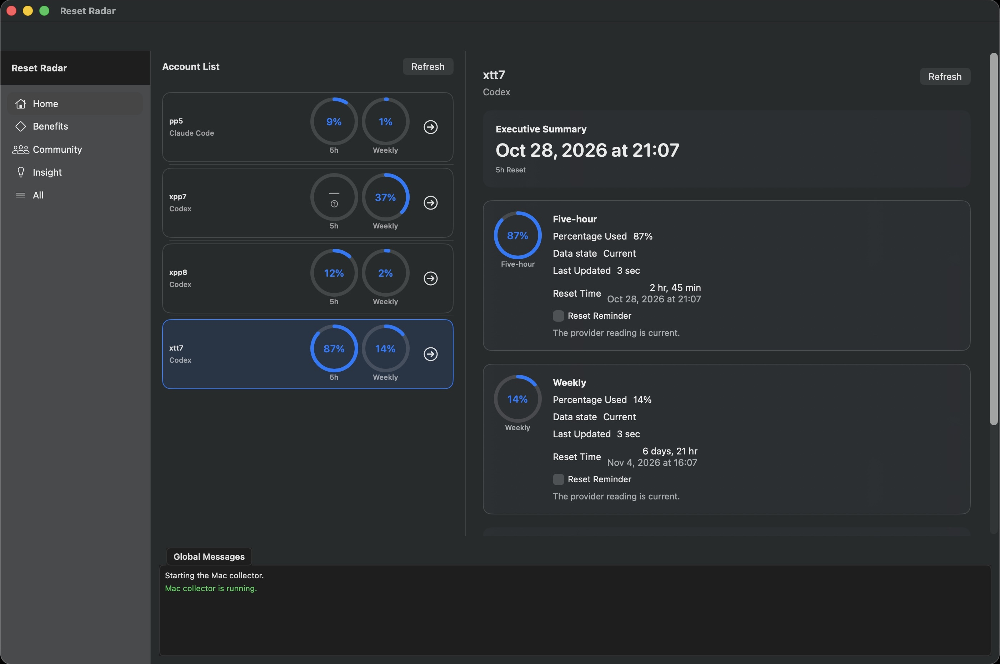
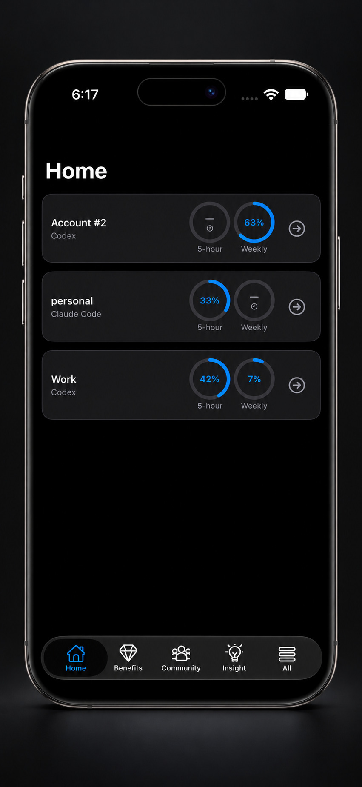

# Reset Radar

See Codex and Claude Code allowance usage and reset times on-the-go.

*See what’s left. Know when it resets.*

### Fast by design

The Apple apps are built in native Swift and SwiftUI for a focused, responsive experience.

### Privacy first

Reset Radar never copies, stores, or sends provider credentials. Allowance snapshots and optional
device profiles are encrypted before relay storage.

### 100 % Free of Charge

No additional API fee is required. If you do sideloading, the supported personal-sideloading path does not require an
annual Apple Developer Program enrollment fee.

## Preview

  Native SwiftUI experiences for the Mac and iPhone.

  

  <strong>macOS</strong> · Review every account and reset at a glance.

  

  <strong>iPhone</strong> · Your allowance windows, always close at hand.

## Documentation

- [Documentation index](docs/README.md) — all active design, research, and planning documents.
- [Product behavior](docs/product-behavior.md) — approved scope and non-goals.
- [Product limitations](docs/product-limitations.md) — privacy, availability, and installation boundaries.
- [Installation and recovery](docs/mac-installation-and-recovery.md) — Collector Mac setup.
- [Sideloading guide](docs/user-guide-for-sideloading.md) — iPhone and iPad installation.
- [Contribution guide](docs/contribution-guide.md) — setup and validation; use `make gate`.

## Release notes

Version v1.0.0

- Fixed a Mac menu-bar crash during allowance-status refresh.

## License

Licensed under the Apache-2.0 license. See [LICENSE](LICENSE).
