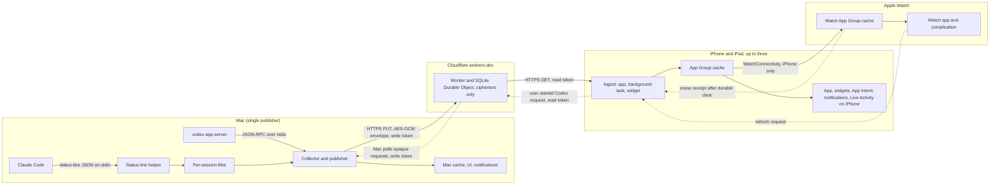
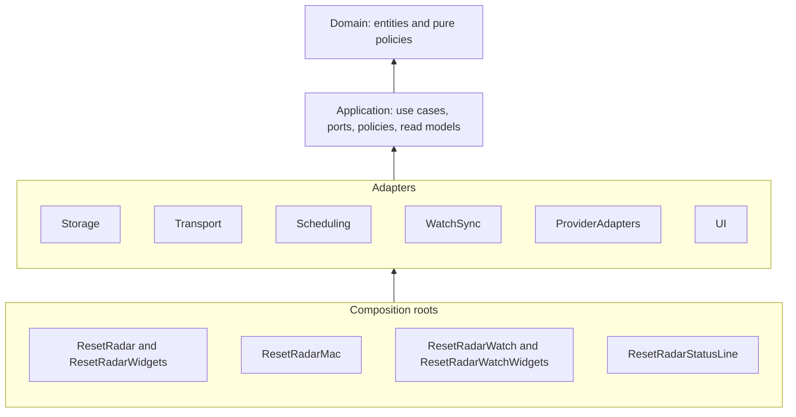
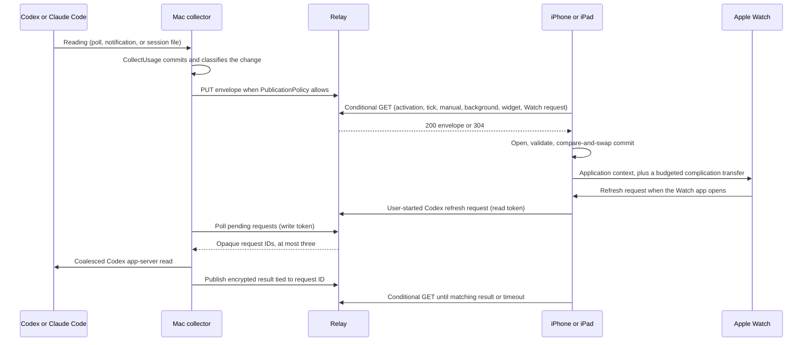

# Software architecture

Status: Active

System-level architecture for Reset Radar across iPhone, iPad, Apple Watch, Mac, and the Cloudflare relay. It defines the layers and modules, linking to a design document for each, along with the platform targets and the end-to-end sync and refresh model. It also covers pairing and loss, trust boundaries, failure behavior, verification, and the build and project contract.

## Architectural principles

- Provider credentials remain inside first-party Codex and Claude Code processes.
- The Mac is the only provider reader and the only publisher.
- Other Apple devices consume normalized, credential-free latest-state snapshots.
- Cloudflare receives only authenticated ciphertext and minimal ordering, authorization, and manual-request metadata.
- Provider-reported percentage used is stored and presented without inversion.
- Observation, publication, receipt, and presentation times remain distinct. No component advances an observation time without evidence of a new provider reading.
- Missing, stale, expired, offline, unauthorized, and incompatible data are never represented as healthy usage.
- No percentage history, forecasting, pace analysis, threshold alerts, manual percentage entry, or manual reset rule exists.
- The window model is open-ended; Home presents one account row at a time with two standard-window
  positions, while Account Details exposes every valid window for that account.
- Source dependencies point inward only: product rules never depend on storage, networking, Keychain, operating-system services, or presentation.

## System context and trust boundaries



The first-party tools own vendor authentication. The Mac reads derived allowance state, normalizes it, keeps the authoritative latest-state cache, encrypts the complete snapshot, and publishes it. The relay authenticates each operation and enforces ordering but cannot decrypt. Each iPhone or iPad authenticates, downloads, decrypts, validates, and atomically commits a newer snapshot. A conditional relay response counts as unchanged only while its matching validated cache exists. A paired Watch receives the normalized snapshot from its iPhone, can ask the iPhone to refresh, and never contacts a provider or the relay. Its delivery revision prevents an older queued message from restoring data after Forget Mac or re-pairing. Forget Mac keeps a clear pending on the iPhone until the Watch acknowledges a durable empty-cache commit; an offline Watch cannot be erased immediately.

Cloudflare can observe transport metadata, opaque publisher and reader identifiers, key versions, sequence numbers, reader activation, opaque manual-refresh request IDs and their times, request sizes, routes, status codes, and network addresses. It must not receive a content key, provider credential, account identifier or email, prompt, response, project path, raw provider payload, or plaintext normalized snapshot. Key holders are listed in [Transport](architecture/transport.md#key-material).

## Layers and modules



The dependency rule, declared in the Swift package's target dependencies:

- Domain depends only on Foundation.
- Application depends only on Domain. It defines every port its use cases need.
- Adapters depend only on Domain and Application. They implement ports and never import one another.
- UI is the presentation adapter. It consumes read models and calls use cases; it never imports another adapter.
- Composition roots are the only places that construct adapters and wire them to use cases.
- Test targets use `ResetRadarTestSupport`, which provides in-memory fakes for every port and is never linked into an app.

### Shared modules

The shared modules are library targets in one local Swift package, `ResetRadarKit`, with no third-party dependencies.

| Module | Layer | Platforms | Responsibility | Design |
|---|---|---|---|---|
| `ResetRadarDomain` | Entities | All | Identity, records, wire conventions, Home slot resolution, and availability policies. | [domain.md](architecture/domain.md) |
| `ResetRadarApplication` | Use cases | All | Use cases, ports, refresh and publication policies, and read models. | [application.md](architecture/application.md) |
| `ResetRadarStorage` | Adapter | All | Versioned atomic files, cross-process locks, preferences, migration, and diagnostics. | [storage.md](architecture/storage.md) |
| `ResetRadarTransport` | Adapter | iOS, macOS | Keychain secrets, key generation, envelope encryption, account scope, pairing codec, and the relay client. | [transport.md](architecture/transport.md) |
| `ResetRadarScheduling` | Adapter | iOS, macOS | Reset notifications and the Reset Live Activity. | [scheduling.md](architecture/scheduling.md) |
| `ResetRadarWatchSync` | Adapter | iOS, watchOS | WatchConnectivity payloads and refresh requests. | [watch-sync.md](architecture/watch-sync.md) |
| `ResetRadarProviderAdapters` | Adapter | macOS | Codex app-server and Claude Code status-line sources, setup, and the helper's components. | [provider-adapters.md](architecture/provider-adapters.md) |
| `ResetRadarUI` | Adapter (presentation) | All | Screen models, shared components, formatting, and accessibility. | [ui.md](architecture/ui.md) |
| `ResetRadarTestSupport` | Test support | All | Port fakes for test targets. | [application.md](architecture/application.md#position) |

The relay is a separate TypeScript package with its own internal layering: [relay.md](architecture/relay.md).

### Composition roots and test targets

| Target | Platform | Role | Design |
|---|---|---|---|
| `ResetRadar` | iOS, iPhone and iPad | App and refresh drivers. | [ios-app.md](architecture/ios-app.md) |
| `ResetRadarWidgets` | iOS | Widgets, widget-reload ingest, and Live Activity views. | [ios-app.md](architecture/ios-app.md#widget-extension) |
| `ResetRadarWatch` | watchOS | Watch app, payload commit, and refresh requests. | [watch-app.md](architecture/watch-app.md) |
| `ResetRadarWatchWidgets` | watchOS | Allowance Complication. | [watch-app.md](architecture/watch-app.md#complication) |
| `ResetRadarMac` | macOS | Collector, publisher, Mac UI, menu-bar extra, and owner flows. | [mac-app.md](architecture/mac-app.md) |
| `ResetRadarStatusLine` | macOS | Helper run by Claude Code. | [provider-adapters.md](architecture/provider-adapters.md#helper-composition) |
| `ResetRadarTests` | iOS | App-level integration tests. | [ios-app.md](architecture/ios-app.md#tests) |
| `ResetRadarMacTests` | macOS | Mac lifecycle and integration tests. | [mac-app.md](architecture/mac-app.md#tests) |
| `ResetRadarWatchTests` | watchOS | Watch payload and complication tests. | [watch-app.md](architecture/watch-app.md#tests) |
| `ResetRadarUITests` | iOS | UI tests on the iPhone and iPad simulators. | [ios-app.md](architecture/ios-app.md#tests) |

### Target imports

| Target | Domain | Application | Storage | Transport | Scheduling | WatchSync | ProviderAdapters | UI |
|---|---|---|---|---|---|---|---|---|
| `ResetRadar` | ✓ | ✓ | ✓ | ✓ | ✓ | ✓ | | ✓ |
| `ResetRadarWidgets` | ✓ | ✓ | ✓ | ✓ | Notifications and activity attributes | | | ✓ |
| `ResetRadarWatch` | ✓ | ✓ | ✓ | | | ✓ | | ✓ |
| `ResetRadarWatchWidgets` | ✓ | ✓ | ✓ | | | | | ✓ |
| `ResetRadarMac` | ✓ | ✓ | ✓ | ✓ | ✓ | | ✓ | ✓ |
| `ResetRadarStatusLine` | ✓ | | | | | | ✓ | |

Watch targets and the status-line helper never import Transport, so they cannot reach the relay or a relay secret. The iOS widget extension imports Transport to run the same validated ingest as the app and Scheduling to reconcile opted-in reset notifications.

## Platform targets

| Platform | Minimum OS and deployment target | Reference device | Simulator destination |
|---|---|---|---|
| iPhone | iOS 26.1 | iPhone 17 Pro Max | `platform=iOS Simulator,name=iPhone 17 Pro Max,OS=26.1` |
| iPad | iPadOS 26.1 (same universal target) | iPad Air 11-inch (M2) | `platform=iOS Simulator,name=iPad Air 11-inch (M2),OS=26.1` |
| Apple Watch | watchOS 26.6 | Apple Watch Series 11 (42mm) | `platform=watchOS Simulator,name=Apple Watch Series 11 (42mm)` |
| Mac | macOS 26.7.1 | MacBook Pro, Apple M5 Max, 128 GB | `platform=macOS` |

Building requires an Xcode whose SDKs are at least iOS 26.1, watchOS 26.6, and macOS 26.7, plus iOS and watchOS simulator runtimes at or above the minimums. Scaffolding confirms that Xcode and the Swift package accept the patch-level deployment targets. If either does not, the build setting uses the minor version (26.6 or 26.7), and the patch minimum remains the supported floor, validated on the reference devices. The iOS and iPadOS floor is the minor version 26.1, the oldest installable simulator runtime that creates both reference devices; it is proven only in the simulator, because the physical reference devices run a newer release.

## Interface structure

[ux-gui.md](ux-gui.md), [ux-information-architecture.md](ux-information-architecture.md), and [ux-terms.md](ux-terms.md) are authoritative for destinations, order, placement, icons, and copy. Their assignment to scenes and targets is in the [iOS app](architecture/ios-app.md#scenes-and-navigation), [Mac app](architecture/mac-app.md#scenes), and [Watch app](architecture/watch-app.md#scenes) designs. Home resolves configured accounts through stable `AccountID` values and orders their rows by displayed alias, with account number as the deterministic tie-breaker. A configured account remains present when its reading is unavailable; unavailable data never removes or silently retargets the account.

## Sync and refresh model

Usage data moves from source to Mac, then to the relay, the iPhone or iPad, and the Watch. A user-started Codex Refresh can send a short-lived request in the other direction, from a paired reader through the relay to an awake Mac. Each hop has its own triggers and limits. Nothing in the pipeline invents freshness: every surface derives its presentation state from the original `observedAt`.



| Stage | Triggers | Cadence and limits | Defined in |
|---|---|---|---|
| Codex collection | Poll, update notification, known reset, wake, manual | Poll every 5 minutes. Notification-triggered reads at least 60 seconds apart. One read 30 seconds after each reset. | [ProviderAdapters](architecture/provider-adapters.md#codex-app-server) |
| Claude Code collection | The helper records each status-line run | `observedAt` advances only on evidence of a new API response; directory events coalesced over 2 seconds. | [ProviderAdapters](architecture/provider-adapters.md#claude-code-status-line) |
| Publication | Transition, material change, heartbeat, wake, network restore | Transitions immediately. Material changes at most every 30 seconds. Observation-only advances on the 5-minute heartbeat. | [Application](architecture/application.md#policies), [Mac app](architecture/mac-app.md#collector-runtime) |
| iOS ingestion | Activation, 60-second foreground tick, manual, background task, Watch request, widget reload | 15-second minimum between automatic fetches across processes. A widget fetches only when the last success is over 5 minutes old. Background earliest begin date is `min(last success + 15 min, next reset + 1 min)`. | [Application](architecture/application.md#policies), [iOS app](architecture/ios-app.md#refresh-drivers) |
| Watch delivery | Every commit or transport-status change; Watch app activation | Application context every time. A complication transfer at most every 30 minutes, and only on Home-slot changes. | [Application](architecture/application.md#policies), [WatchSync](architecture/watch-sync.md#channels) |
| Manual Mac-assisted refresh | User-started Codex Refresh on iPhone or iPad | Reader request at most once per 60 seconds; Mac request poll every 15 seconds while running; remote-forced Codex read at most once per 30 seconds; reader waits at most 45 seconds. No request is sent for a Claude Code-only Refresh or an automatic trigger. | [Application](architecture/application.md#use-cases), [Relay](architecture/relay.md#protocol) |

### What the owner can expect

| Situation | Typical delay from a provider change to the device |
|---|---|
| iPhone or iPad app open | Codex: up to the 5-minute poll plus up to 60 seconds. Claude Code: up to the 30-second coalescing plus up to 60 seconds. |
| Widgets, app closed | At least 5 minutes, bounded by WidgetKit's reload budget. |
| App and widgets idle | Until a background task runs, which the system may never do. |
| Watch app opened, iPhone reachable | One iPhone fetch round trip. |
| Manual Codex Refresh, Mac awake | A bounded request/read/publication round trip, normally within the 45-second wait; a matching encrypted result confirms completion. Exact latency is a spike result, not a guarantee. |
| Manual Codex Refresh, Mac asleep or offline | The 45-second wait expires and the device keeps its last valid cache. The request cannot wake the Mac. |
| Mac asleep or off | No new data. Every surface turns stale on schedule. |

With a fifteen-minute Codex current-data window, glanceable surfaces on iPhone, iPad, and Watch often show Codex as stale between app opens. That is the intended honest behavior under opportunistic refresh.

### Relay capacity

| Load | Typical day | Worst case |
|---|---|---|
| Mac publications | About 770 as a conservative sum of heartbeats and changes over 4 hours of activity | At most about 6,050: 2,880 ordinary changes, 288 conservatively counted heartbeats, and 2,880 manual-read results |
| Ordinary reads per reader | About 340: 2 hours in the foreground, background tasks, widgets, and Watch requests | About 1,930: in the foreground all day, widgets every 5 minutes, background tasks, and Watch requests |
| Manual reader requests and follow-up reads | Occasional owner actions | At most 4,320 accepted POSTs plus 43,200 snapshot GETs: three readers each requesting once a minute, with one initial and nine five-second follow-up reads per request |
| Mac request-list polls | About 5,760 while collecting all day | About 5,760 at one poll every 15 seconds |
| Mac request acknowledgements | One per handled reader request | At most 4,320 idempotent DELETEs after encrypted publication |
| Total Worker requests, three readers | Ordinary load plus actual manual actions | Under about 69,500 for the intended clients at all stated maxima, including the conservative publication and ordinary-read sums; below the current Free daily 100,000 request limit |
| SQLite rows written | Actual writes depend on overlap and indexes | Count snapshot replacement, each accepted request, reader rate-limit update, acknowledgement, and index maintenance in the synthetic spike against the Free daily 100,000-row limit |

This is a conservative intended-client budget, not a protection against a compromised token flooding rejected requests. It uses Cloudflare's published [Workers Free request limit](https://developers.cloudflare.com/workers/platform/limits/) and [SQLite Durable Object Free limits](https://developers.cloudflare.com/durable-objects/platform/pricing/), which must be rechecked before deployment. Free-tier exhaustion fails closed and cannot trigger a paid upgrade. Pairing adds one registration, one preflight, one activation plus retries if needed, and about 60 Mac list polls per pairing. Relay conformance measures actual requests, rows, CPU, duration, latency, and cellular data, including manual refresh at its rate limit.

## Pairing, revocation, and loss

### Relay setup

The owner deploys the single-tenant Worker on `workers.dev` under Workers Free with no paid add-on. Setup then runs in this order:

1. **Generate.** The Mac pauses publication, generates the relay secrets and a new publisher ID, and persists them in a pending-setup state. An interrupted setup can be resumed with the same secrets and digests.
2. **Provision.** The owner runs the relay package's provisioning command. It reads the write and administration digests from standard input, copied from Mac Settings, and writes them as Worker secrets without echoing them or exposing them in shell history. Writing new digests invalidates every earlier write and administration token.
3. **Wipe.** The Mac clears relay storage with the new administration token, so no state written under earlier tokens survives.
4. **Bind.** The Mac's first publish binds the new publisher ID. Only then does setup become active and ordinary publication resume. A failed provisioning, wipe, or bind keeps publication paused and offers a retry from the recorded step.

Setup after destruction, publisher replacement, or suspected compromise follows the same steps.

### Pairing a reader

1. **Register.** The Mac registers a pending reader. The relay assigns a five-minute deadline and removes an unactivated registration after that deadline on its next request.
2. **Show the package.** The Mac shows a QR pairing package containing the endpoint, `ReaderID`, the reader's token, the content key, publisher ID, key version, minimum acceptable sequence, and relay-assigned registration expiry. The Mac also shows a short confirmation code over the complete encoded package. The package stays valid until that expiry in the Mac UI. The content key it carries does not expire, so the screen must not be shared or recorded during pairing.
3. **Confirm on the reader.** The iPhone or iPad scans the code with the camera, or accepts a manual copy/paste fallback. Manual Copy is a separate warned action because the package's content key remains valid after the registration deadline and the Mac system pasteboard may share it through Universal Clipboard. The Mac conditionally clears only its own unchanged clipboard value at activation, expiry, view closure, or next launch; it cannot retract a copy on another device. The reader previews the endpoint and independently calculated package confirmation code. The owner compares that code with the Mac's display and explicitly confirms before the reader sends its token to the endpoint. A publisher-ID fingerprint alone cannot detect a substituted endpoint or content key.
4. **Preflight and commit.** The reader performs one authenticated read, validates any returned envelope, and treats an authenticated first-publish `404` as a valid empty preflight. A preflight read does not activate it. The reader then saves the Keychain items and local pairing state, including an `awaitingActivation` marker, before sending activation. A reader already paired to another Mac must use Forget Mac before starting this flow; the new pairing never inherits its old ETag, snapshot, or relay sequence.
5. **Activate or recover.** The reader sends `POST /v1/readers/activate` with its read token only after the local save succeeds. A successful response clears `awaitingActivation`; an interrupted response is retried idempotently on foreground return, even if the displayed deadline has passed, because the first response might have been lost after activation. If local save fails, the reader removes any staged secrets and does not activate. Only an authenticated `401` establishes that the pending registration expired or was revoked; the reader then removes the staged pairing and asks the owner to re-pair.
6. **Close or clean up.** While the QR is visible, the Mac polls `GET /v1/readers` every five seconds. It hides the package only after confirmed activation, and revokes a reader still pending at expiry. Pending registrations are persisted, so a Mac that quits mid-pairing revokes expired pending readers on its next launch; relay-side expiry also prevents later activation.

### Paired devices and rollback

Mac Settings lists readers by owner-assigned name and pairing date. Those names are kept only on the Mac and reconciled with `GET /v1/readers`; a registered reader unknown to the Mac appears as an unknown device. Each entry offers Revoke. Revoking suits a retired device. A lost or compromised device still requires setup and re-pairing, because the content key cannot be withdrawn.

Each reader tracks the highest accepted sequence and rejects anything below it or below the pairing floor. Repeated old responses become a redacted diagnostic without replacing cache state. The iPhone also persists a separate, increasing Watch delivery revision across Forget Mac and re-pairing; the Watch rejects lower revisions from the same iPhone installation. If iPhone app data is erased and its installation identity changes, Watch pairing reset requires owner confirmation. A pending Watch clear is durable across iPhone relaunch and new Mac pairing and blocks any later Watch usage payload until a receipt for that exact revision arrives.

### Forget, destroy, and loss

**Forget Mac** on an iPhone or iPad atomically hides its old snapshot and persists local-cleanup state, then removes its Keychain items, pairing-specific reader state, scheduled notifications, and Live Activities. Interrupted cleanup remains visible and blocks new pairing until retried. On iPhone it persists a cleared Watch payload and pending-erasure marker before attempting delivery. The Watch commits the empty cache and a revision tombstone, asks watchOS to reload its complication, then queues a receipt. Until the iPhone receives that matching receipt, Settings says Watch erasure is pending and resends the clear on reconnection; it never claims that an unreachable Watch was erased. A receipt establishes cache erasure on one responding Watch, but not on another paired Watch, and watchOS may briefly retain a previously rendered complication frame. The Watch app also offers local erase with a hold against later usage delivery. Forget Mac does not contact the relay; the reader stays registered until revoked on the Mac.

**Destroy Relay** on the Mac persists `destroyPending`, pauses publication, and deletes remote storage, then deletes the local relay secrets, in-memory secret cache, sequence, publisher ID, and paired-device list. A failed or interrupted remote delete keeps the local state for retry, never reports success, and leaves publication paused after relaunch. The Mac's own usage cache and notifications are unaffected. The old write and administration digests remain as Worker secrets until the next setup replaces them, but no remaining device holds the matching tokens. Under suspected compromise, the owner runs setup again or deletes the Worker before trusting the relay.

**Lost Mac.** The owner deletes the Worker and its Durable Object in the Cloudflare dashboard, which invalidates every token and discards the stored ciphertext. There is no key recovery service.

## Diagnostics and privacy

Diagnostics are structured `DiagnosticEvent`s that accept no free-form strings (see [Domain](architecture/domain.md#records)). They may include app and source versions, state enums, durations, sequence ranges, schema versions, HTTP status classes, and timestamps.

They never contain:

- tokens, keys, digests, or ciphertext;
- publisher and reader IDs;
- account identifiers or session identifiers;
- executable and user paths, or environment values; or
- raw provider payloads, prompts, responses, or Claude Code status-line input.

A user-visible diagnostics export requires confirmation. Normal operation uses unified local logging with privacy markers and no Cloudflare logs or traces.

## Failure behavior

| Condition | Required behavior |
|---|---|
| Provider not installed or signed out | Keep the last observation as stale, expose a setup action, and never fall back to credentials or private endpoints. |
| Adapter incompatible or malformed | Preserve the cache, mark only the affected account incompatible, and stop tight retries. |
| Existing Claude Code status-line command could contain a secret or cannot be parsed safely | Leave Claude Code settings untouched, create no restore record, and explain that automatic composition is unavailable. |
| One window invalid | Reject that window's observation only, and keep the other windows. |
| Reset passes without new data | Show reset-awaiting-refresh and remove the ring value; never synthesize 0%. |
| A provider stops reporting a standard Home window and its last reset passes | Show that account row's ring as unavailable; retain the old observation only for diagnostics until a new report arrives. |
| Manual Mac-assisted refresh times out or the Mac is asleep | Keep the latest valid cache, identify that the Mac did not complete the request, and never mark an unrelated relay contact as a successful Codex read. |
| Codex account changes | Drop the prior scope's windows, replace or cancel affected notifications, and end affected Live Activities. |
| Claude Code account changes | Not detectable. A newer observation replaces the same window kind, while unmatched old kinds remain stale and become unavailable after their last known reset; the UI never claims to have verified account identity. |
| Concurrent Claude Code sessions | The newest observation per window wins; an idle session cannot regress it. |
| Mac sleeps or quits | Readers and Watch retain their caches and age presentation state normally; on wake the Mac refreshes and publishes immediately. |
| Mac network lost | Keep the latest state only, and publish as soon as the path is satisfied. |
| Second Mac instance launches | It activates the running instance and exits. |
| Mac Keychain needs interaction at process start | Pause publication with `secretsUnavailable`, retry every minute and on session activation, then show the recovery screen. Never prompt and never regenerate secrets silently. A later Keychain lock does not evict secrets already held by the running process or pause it; Settings discloses this behavior. |
| iPhone secrets unavailable before first unlock | Keep the cache, report `secretsUnavailable`, and retry on the next trigger. |
| Pairing preflight, local save, or activation fails | A preflight read never activates the reader. Failed local save removes staged secrets. An interrupted activation response leaves `awaitingActivation` for idempotent retry; only a relay `401` clears the pending pairing. |
| Widget commits while the app is not running | The extension reconciles opted-in reset notifications before its timeline completes, without asking for authorization. The app retries unfinished notification work and updates Live Activities and the Watch on its next run. |
| Relay returns `304` after the local cache was lost | Clear the old ETag and retry once unconditionally; do not treat the missing cache as current. |
| A delayed Watch message arrives after Forget Mac or re-pairing | Reject a lower delivery revision, including an old clear or an old publisher. Preserve a durable clear tombstone and withhold new Watch usage until its matching erase receipt. A changed iPhone installation requires Watch-side reset confirmation. |
| Watch unreachable during Forget Mac | Clear iPhone data immediately, retain a pending Watch clear, and report remote erasure as unconfirmed. Resend on Watch-session activation. A Watch-local erase is available; neither path promises immediate removal of a previously rendered complication frame. |
| Oversized source or relay response, or relay redirect | Stop the bounded read, keep the last valid cache, and surface a typed source or transport failure. Never follow a redirect with a bearer token. |
| Relay unauthorized | Stop automatic retries and require re-pairing. |
| Relay publication conflict (`409`) | Stop automatic publication and offer setup and re-pairing. |
| Relay quota, rate limit, or outage | Back off with jitter, retain the cache, and show transport offline or quota-limited. |
| Replay, wrong key, invalid tag, or unexpected publisher | Reject without cache replacement and expose a redacted invalid-snapshot diagnostic. |
| Unknown mandatory schema or protocol | Preserve prior data, mark incompatible, and require an update or recovery flow. |
| Watch unreachable | Queue only the latest application context and keep the Watch cache visibly stale. A refresh request that cannot reach the iPhone is not an error. |
| Notification or Live Activity permission denied | Keep tracking functional and show the denied state without repeated prompts. |

## Verification

### Module tests

Each module and composition-root design lists its automated tests. The tests run in the gate against synthetic fixtures and `ResetRadarTestSupport` fakes; no gate test touches the real Keychain, network, provider tools, or paired devices.

### Platform behavior to be proven on real runtimes

Each of these is exercised on the reference devices in [Platform targets](#platform-targets). Synthetic data is used in isolated harnesses, and the real first-party tools only where noted. None of the harness code is product code.

- **Shared storage and Keychain:**
  - App Group sharing between the iOS app and widget extension, including the cross-process lock;
  - Watch App Group sharing between the Watch app and its complication;
  - iOS Keychain access after first unlock from the app and the widget extension; and
  - Mac login-Keychain access with no dialog across a rebuild, at login launch after a reboot, and at least eight days after signing, plus an error, never a dialog, for an ad-hoc build or a keychain locked before launch; a later lock preserves the running process's cached-secret behavior;
  - iOS Keychain items still readable by the app and widget extension after a Sideloadly re-sign; and
  - an app suspended, or a background task expiring, during a locked claim or commit leaves no held lock and no termination.
- **Refresh timing:**
  - Mac timer drift with the main window closed over 24 hours, confirming App Nap is held off;
  - the actual run intervals of the iOS background task over 24 hours; and
  - widget-reload ingest within the WidgetKit budget, on iPhone and iPad.
  - Mac-assisted manual-refresh latency, rate limits, source read, encrypted acknowledgement, sleeping-Mac timeout, and Free-tier usage on iPhone and iPad.
  - notification replacement and cancellation from a widget-only commit, including expiry before reconciliation completes.
- **WidgetKit and ActivityKit:**
  - WidgetKit configuration and timeline-entry degradation at threshold crossings;
  - Live Activity start, update, stale display, the eight-hour end, and absence on iPad.
- **Notifications:**
  - local notification reconciliation on iPhone, iPad, and Mac;
  - a fixed fire instant across a time-zone change.
- **Watch delivery:**
  - WatchConnectivity delivery in the foreground and background, plus offline caching;
  - Forget Mac with the Watch offline, a durable pending clear across iPhone relaunch and new Mac pairing, a matching receipt after Watch cache erasure, stale-receipt rejection, and eventual complication reload;
  - a Watch-initiated refresh that wakes the iPhone app and returns a payload before the message times out;
  - `transferCurrentComplicationUserInfo` within its budget; and
  - complication reload.
- **Mac and installation:**
  - `SMAppService.mainApp` state;
  - Sideloadly installation on iPhone, iPad, and Watch.
  - physical iPhone QR pairing;
- **First-party tools:**
  - Codex app-server method and field shape, default-bucket identity, notification frequency, and child exit on standard-input close;
  - legitimate Codex JSON-RPC messages fitting the bounded frame, string, nesting, and window limits;
  - Claude Code status-line payload shape, idle rerun behavior, and `cost.total_api_duration_ms` progression.

### Source calibration

The current-data windows are fifteen minutes for Codex and sixty minutes for Claude Code, both
confirmed by owner-present source calibration on 2026-10-25. Calibration also confirms the Claude
Code new-response and idle non-advancement signals described in
[ProviderAdapters](architecture/provider-adapters.md#observation-time). A future contradiction
returns the affected rule to the owner; it is never replaced by an invented value.

Evidence records only installed version, supported method and field shape, response and update timing, calibration result, and pass or fail. It never records raw responses, credentials, account identifiers, session identifiers, prompts, response content, or project paths.

### Relay conformance

The relay satisfies the following before it carries real provider data:

- it runs on Workers Free with no paid subscription or add-on, and with logs, traces, Logpush, and unused bindings disabled;
- every operation and response in the [relay protocol](architecture/relay.md#protocol) behaves as specified with a synthetic Mac source and synthetic snapshots, including:
  - publisher binding;
  - preflight without activation, confirmation after local save, idempotent lost-response retry, pending expiry, reader listing, and the cap;
  - setup ordering; and
  - manual-refresh authentication, request expiry, rate limits, revocation, encrypted acknowledgement, and a sleeping Mac; and
  - generic errors;
- the exact response at the Free daily limit is recorded and maps to `quotaLimited`;
- request, CPU, Durable Object duration, rows read and written, storage, p50/p95 latency, and cellular data stay within the free quotas at the worst-case cadence in [Relay capacity](#relay-capacity);
- ciphertext published on Mac Wi-Fi is retrievable and decryptable on iPhone cellular with the Mac disconnected;
- quota exhaustion, rate limiting, clock skew, malformed ciphertext, wrong keys, replay, incompatible versions, deployment promotion, and rollback preserve the last valid cache; and
- teardown leaves no stored state, and billing remains US$0.

Failure of the cost, plaintext, credential, cellular, deletion, or recovery boundary rules the relay out. No alternate transport is adopted without a separate decision.

## Build and project contract

**Repository layout:**

- **Xcode project.** `ResetRadar.xcodeproj` defines every composition-root and test target in [Composition roots and test targets](#composition-roots-and-test-targets).
- **Shared package.** The local `ResetRadarKit` package defines every module in [Shared modules](#shared-modules). Each module has a test target named `<Module>Tests`, except UI's, which is `ResetRadarUIComponentTests`. Target dependencies declare the dependency rule. Scaffolding confirms how a violating import is rejected, for example with SwiftPM's explicit target-dependency import check.
- **Relay package.** `relay/` holds the relay; see [relay.md](architecture/relay.md#operations).

**Build settings:**

- **Language.** Swift 6 language mode with strict concurrency checking.
- **Deployment targets.** As listed in [Platform targets](#platform-targets).
- **Build configurations.** Development and release.

**Signing:**

- **Bundle identifiers.** Deterministic and kept stable within the free account's App ID budget. The Watch app's identifier is prefixed by the iOS app's.
- **iOS and watchOS.** Personal Team-compatible signing, and installation through Sideloadly.
- **Mac.** The single Apple Development identity and build check in the [Mac app](architecture/mac-app.md#signing-and-keychain).

**Capabilities.** Each composition root's configuration table lists its capabilities: [iOS app](architecture/ios-app.md#configuration), [Watch app](architecture/watch-app.md#configuration), and [Mac app](architecture/mac-app.md#configuration). Across all targets:

- one App Group identifier for the iOS app, its widget extension, the Watch app, and the complication;
- no Push Notifications, iCloud, CloudKit, analytics, or provider-credential entitlement;
- no Mac entitlement that requires a provisioning profile; and
- bitmap asset names and accessibility labels that match the UX vocabulary.

**Tests.** Each scheme's test plan runs the package test targets for the modules its platform uses, plus its own app-level test bundle.

The complete gate is:

```sh
Scripts/generate-project.sh
Scripts/lint-swift-format.sh
swiftlint --strict
Scripts/check-imports.sh
xcodebuild test -scheme ResetRadarMac -destination 'platform=macOS'
# iOS, iPad, and Watch test runs are suspended until those apps have implementation; see the contribution guide
npm --prefix relay ci
npm --prefix relay test && npm --prefix relay run typecheck && npm --prefix relay run deploy:dry-run
```
