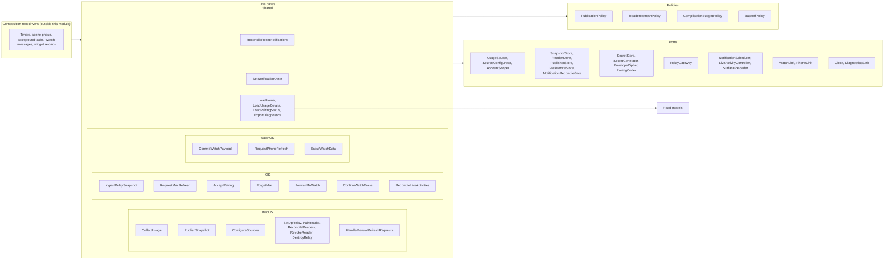

# Application module

Status: Proposal

`ResetRadarApplication` is the use-case layer of the [software architecture](../architecture.md). It decides what Reset Radar does and when, through use cases, policies, and read models. It reaches storage, the relay, Keychain, system services, and provider sources only through ports that it defines and outer modules implement.

## Position

| Property | Value |
|---|---|
| Layer | Use cases |
| Platforms | iOS, macOS, watchOS; each composition root wires only the use cases for its platform |
| Depends on | [Domain](domain.md) and Foundation |
| Used by | Every adapter (to implement ports), [UI](ui.md), composition roots, and `ResetRadarTestSupport` |

Rules:

- Imports only Domain and Foundation, never CryptoKit, Security, UserNotifications, ActivityKit, WatchConnectivity, WidgetKit, or SwiftUI.
- Every port is a `Sendable` protocol named for the product need, such as `SnapshotStore`, not for a technology, such as `FileStore`.
- Use cases are actors or `Sendable` structs that receive ports through their initializers; they never construct adapters.
- Time comes from the `Clock` port and randomness from the `SecretGenerator` port.
- Use cases own no timers. Drivers in the composition roots call them, and policies return the next due instant.
- `ResetRadarTestSupport`, a library linked only into test targets, provides an in-memory fake for every port.

## Internal architecture

Adapters implement the ports from outside; the arrows show compile-time dependencies, and none point out of this module except to Domain.

## Ports

| Port | Purpose | Implemented by |
|---|---|---|
| `UsageSource` | Start, refresh, stop, and stream `SourceSnapshot`s for one product (macOS). | [ProviderAdapters](provider-adapters.md) |
| `SourceConfigurator` | Inspect, preview, apply, and restore a source's local setup, such as Codex discovery or the Claude Code status line. | [ProviderAdapters](provider-adapters.md) |
| `AccountScoper` | Turn a provider account identifier into an `AccountScope` without retaining the identifier. | [Transport](transport.md) |
| `SnapshotStore` | Load and clear the committed snapshot. Mac collection commits locally without a relay sequence; iPhone/iPad ingestion compares relay sequences; Watch commits compare iPhone delivery revisions. | [Storage](storage.md) |
| `ReaderStore` | iOS pairing metadata, ingest state, Watch delivery revision, and a durable pending Watch-erasure marker. Claims fetches and commits results under a cross-process lock. | [Storage](storage.md) |
| `PublisherStore` | Mac relay metadata: endpoint, publisher ID, sequence (persisted before each send), paired-device names, and pending registrations. | [Storage](storage.md) |
| `PreferenceStore` | Per-device notification opt-in and other typed preferences. | [Storage](storage.md) |
| `NotificationReconcileGate` | Serialize reset-notification reconciliation across the iOS app and widget extension, with a bounded claim and retry after interruption. | [Storage](storage.md) |
| `SecretStore` | Non-interactive read, write, and delete of named secrets. Fails with `interactionRequired` instead of prompting. | [Transport](transport.md) |
| `SecretGenerator` | Random 256-bit keys, tokens, and identifiers, plus token digests. | [Transport](transport.md) |
| `EnvelopeCipher` | Seal a snapshot under an `EnvelopeHeader`; open and authenticate an envelope. | [Transport](transport.md) |
| `PairingCodec` | Encode and decode a `PairingPackage` for QR and manual transfer. | [Transport](transport.md) |
| `RelayGateway` | Snapshot, reader, and manual-refresh relay operations, returning typed outcomes. | [Transport](transport.md) |
| `NotificationScheduler` | Authorization state, pending reset requests, schedule, and cancel. | [Scheduling](scheduling.md) |
| `LiveActivityController` | List, start, update, and end Reset Live Activities (iPhone). | [Scheduling](scheduling.md) |
| `WatchLink` | iPhone side: send the application context and complication transfers, and receive refresh requests and Watch-erasure receipts. | [WatchSync](watch-sync.md) |
| `PhoneLink` | Watch side: receive payloads, request a refresh from the iPhone, and queue a Watch-erasure receipt. | [WatchSync](watch-sync.md) |
| `SurfaceReloader` | Ask the system to reload widget or complication timelines. | Composition roots ([iOS](ios-app.md), [Watch](watch-app.md)) |
| `Clock` | Current time. | Composition roots; fixed clocks in tests |
| `DiagnosticsSink` | Record a `DiagnosticEvent`. | [Storage](storage.md) |

## Use cases

### Collection and publication (macOS)

**`CollectUsage`** merges the latest `SourceSnapshot` from each `UsageSource` into the authoritative `UsageSnapshot`:

- A window absent from the latest report stays, marked `retained`, with its last observation.
- A newer report of the same `WindowID` replaces a retained window, and an account-scope change drops it.
- A retained window that does not resolve to a Home slot is dropped once its reset passes, or immediately if it has no reset instant.
- A retained Home window with no reset instant, or whose last known reset has passed, remains only for diagnostics; Domain resolves its slot as unavailable until a new provider report arrives. This keeps the four Home cells stable without showing a reset-awaiting-refresh ring forever.
- When Codex reports a new account scope, windows of the prior scope are dropped and never merged.

It commits locally through `SnapshotStore`, without assigning a relay sequence, and classifies the change:

| Change | Meaning |
|---|---|
| `none` | Nothing differs. |
| `observationOnly` | Only `observedAt` advanced. |
| `material` | A percentage or reset instant changed. |
| `transition` | Source state, the window set, report state, or account scope changed. |

**`PublishSnapshot`** asks `PublicationPolicy` whether the change is due. If it is, it:

1. reads the secrets once per process from `SecretStore`;
2. increments the sequence through `PublisherStore`, persisting it before sending;
3. seals the snapshot through `EnvelopeCipher`;
4. rejects an encoded envelope over the relay's 64 KiB request limit without truncating windows or sending plaintext;
5. sends it through `RelayGateway`; and
6. maps the outcome with `BackoffPolicy`.

It never runs before relay setup. An oversized envelope is a typed incompatibility that leaves the last relay snapshot in place and stops automatic retries until the source shape or application changes. It stops automatic retries on `400`, `401`, `409`, `413`, or `422`, and reports `secretsUnavailable` when `SecretStore` fails with `interactionRequired`.

**`ConfigureSources`** drives `SourceConfigurator` for Codex discovery and the Claude Code guided setup. It always shows a preview first and applies changes only after confirmation.

**`HandleManualRefreshRequests`** runs when the Mac's relay-request driver sees one or more pending IDs. It coalesces IDs into one Codex read and never creates a Claude Code response. A read started after the request was observed, or already in flight when it was observed, may satisfy it. After that read completes, it adds a `ManualRefreshResult` for each handled ID to the local snapshot and publishes immediately, even when the percentage is unchanged. A failed read publishes `sourceUnavailable` if the relay remains reachable. It keeps results in subsequent snapshots for two minutes, then acknowledges each request to the relay only after the result-bearing publication succeeds. If publication fails, the requests remain pending until relay expiry and the phone's wait times out. The Mac accepts no more than one remote-forced Codex read per 30 seconds; requests arriving during that interval wait for the next permitted read. Repeated relay polls never repeat an in-flight or completed request.

**Relay administration** follows the setup and pairing lifecycle in [Pairing, revocation, and loss](../architecture.md#pairing-revocation-and-loss):

| Use case | Responsibility |
|---|---|
| `SetUpRelay` | Pause publication, persist a recoverable pending setup with new secrets and publisher ID, produce the digests for provisioning, then wipe and bind. Publication resumes only after binding succeeds. |
| `PairReader` | Register a pending reader, retain its relay-assigned deadline, produce the `PairingPackage`, poll confirmed activation, and revoke at expiry. |
| `ReconcileReaders` | Merge local names with the relay list, and revoke expired pending readers at launch. |
| `RevokeReader` | Revoke one reader. |
| `DestroyRelay` | Persist a `destroyPending` state and pause publication, delete remote storage, then delete Keychain and in-memory secrets and local relay state. On remote failure, retain the local state for retry; a relaunch remains paused. |

### Reader ingestion (iOS)

**`IngestRelaySnapshot`** is the single path by which an iPhone or iPad accepts data, whatever the trigger. Each run takes a `trigger` (`foregroundActivation`, `foregroundTick`, `manual`, `backgroundTask`, `watchRequest`, or `widgetReload`):

1. **Claim.** `ReaderStore.claimFetch` asks `ReaderRefreshPolicy` whether this trigger may fetch now and, if so, records a unique claim ID, bounded in-flight lease, and the attempt under the cross-process lock. A concurrent trigger reports `inProgress` rather than starting another network request. A crashed fetch's lease expires after the client's resource timeout.
2. **Fetch.** Outside the lock, call `RelayGateway.getSnapshot`. Send the stored ETag only when a validated snapshot for that publisher and ETag is still committed. If a `304` arrives without that snapshot, clear the ETag and retry once unconditionally.
3. **Open and validate.** On `200`, open the envelope with `EnvelopeCipher`. Then check:
   - the header's publisher matches the pairing;
   - the sequence is at least the pairing floor;
   - the snapshot's own validation passes.
4. **Commit.** Under one lock and atomic transaction, apply the result only if its claim ID still owns the current lease. Commit through `SnapshotStore` only if the sequence is greater than the committed one, and update ETag, contact time, and transport status in `ReaderStore`. A widget-process commit sets `needsAppReconcile` in that same transaction. Release the in-flight lease. A late result from an expired claim cannot overwrite a newer success or its transport status. Never retain an ETag from an envelope that failed authentication or validation.
5. **Outcome.** Return `committed`, `unchanged`, `inProgress`, `skipped`, or `failed(TransportStatus)`. Every failure preserves the committed snapshot. An authenticated `404` before the first publish is `awaitingFirstPublish`, never a successful empty snapshot.

When the run is in the app process, a `committed` outcome triggers the after-commit pipeline:

- `SurfaceReloader` reloads widget timelines;
- `ReconcileResetNotifications` and `ReconcileLiveActivities` run; and
- `ForwardToWatch` updates the Watch.

A commit made in the widget process attempts reset-notification reconciliation using the already granted, per-slot opt-in state. The extension never requests notification authorization. The atomic `needsAppReconcile` flag makes the app retry notification reconciliation and update Live Activities and the Watch on its next run even if the extension expires mid-reconciliation.

**`RequestMacRefresh`** is called only by a user-started Refresh that includes Codex. It first performs an ordinary conditional relay read, then posts a random request ID using the reader's read token. It polls conditional snapshot reads every five seconds for at most 45 seconds and reports Mac completion only after a newer, authenticated snapshot contains a matching `ManualRefreshResult` for its `ReaderID` and request ID. An unchanged `304`, an unrelated publication, or a locally fresh cache does not complete the request. A `sourceUnavailable` result is reported separately from a successful Codex read. If the Mac is asleep, the request is rate-limited, the relay fails, or the wait expires, it returns the latest valid cache and a specific pending/unavailable outcome. It does not retry the POST automatically or ask the Mac to read Claude Code. A manual Refresh scoped only to Claude Code performs the ordinary relay read without posting a request.

**`AcceptPairing`** decodes and previews a `PairingPackage`, requires confirmation, then performs one authenticated preflight read. It validates a returned envelope or accepts an authenticated first-publish `404`; the read itself does not activate the token. It writes a recoverable local staging marker, saves the Keychain secrets, then atomically commits the pairing metadata, validated preflight snapshot if present, and `awaitingActivation` state. It sends `POST /v1/readers/activate` only after that local commit. An activation response lost to the network leaves the saved state pending and is retried idempotently on app launch or foreground activation, even after the displayed deadline: the relay may have activated before its response was lost. While awaiting activation, the preflight snapshot is not presented as a completed pairing, and ordinary refresh and widget fetches are paused. A Keychain or local commit failure removes staged secrets without sending activation; only an authenticated `401` after expiry or revocation clears the pending pairing and asks for re-pairing. A crash during staging is reconciled before the next pairing or fetch. A reader with an existing pairing must use `ForgetMac` before accepting another package, so a new publisher cannot inherit the old cache, ETag, or sequence floor.

**`ForgetMac`** atomically removes the committed iPhone snapshot and pairing-specific reader state, invalidates any in-flight fetch claim, and preserves its installation ID while advancing its Watch delivery revision. That transaction sets `forgetCleanupPending` and, if this installation has sent data to a Watch, persists a cleared `WatchPayload` and `watchErasePending` before Keychain deletion or Watch delivery. It then deletes Keychain items and cancels local notifications and Live Activities; only after those steps succeed does it clear `forgetCleanupPending` and report local forgetting complete. A failure retains the marker, hides old usage, blocks a new pairing and relay fetch, and offers retry on launch. A late response from the old claim cannot restore the forgotten snapshot or its ETag. The iPad has no Watch stage. The iPhone UI reports Watch erasure as pending until a matching receipt arrives. The user may pair a new Mac after local cleanup while Watch erasure is pending, but no new usage payload may replace the queued clear or reach the Watch before its receipt. An unreachable or lost Watch cannot be remotely erased by this app; the owner can erase Reset Radar data directly in the Watch app when it is available.

**`ForwardToWatch`** builds a `WatchPayload` and sends it as the application context after every commit or transport-status change. It removes transient `ManualRefreshResult`s from the Watch copy of the snapshot; the Watch needs usage state, not other readers' opaque request IDs. It advances and persists one delivery revision per distinct payload; both Watch channels and any reply for that payload carry the same revision. It also uses a complication transfer when `ComplicationBudgetPolicy` allows. While `watchErasePending` exists, it sends or resends only that saved clear, including in a reply to a Watch refresh request; later usage waits for acknowledgement.

**`ConfirmWatchErase`** accepts only a versioned `WatchEraseReceipt` from `WatchLink` for the same iPhone installation ID and pending clear revision. It clears `watchErasePending` and records the confirmed revision and time atomically, ignores duplicates and older or unrelated receipts, and then permits `ForwardToWatch` to send the latest newly paired snapshot at a higher revision. The receipt proves one responding Watch committed an empty cache and requested a complication reload; it cannot prove that watchOS has already removed every rendered complication frame or that another paired Watch was erased.

### Watch (watchOS)

**`CommitWatchPayload`** validates a payload and commits it through `SnapshotStore` with these ordering rules:

- a higher delivery revision from the same iPhone installation replaces the cache or updates transport fields; a clear at that revision erases the cache;
- an equal revision is idempotent only when its payload is identical; conflicting content is rejected;
- a lower revision is ignored, even when it carries a different publisher or a clear; and
- a different iPhone installation ID never silently replaces the cache. The Watch presents a reset-pairing action; after owner confirmation it clears the old cache and accepts the new installation's payload.

A cleared payload is committed as a durable tombstone containing its installation ID and revision, with no usage snapshot. After the commit and a complication reload request, `CommitWatchPayload` asks `PhoneLink` to queue a `WatchEraseReceipt`. Repeated identical clears requeue the same receipt; a stale clear never produces one. A Watch-local erase sets a durable hold that rejects future usage payloads until the owner resets Watch pairing; it keeps the tombstone and may still accept a newer clear and send its receipt. If the Watch app has been reinstalled and no longer has its prior cache or revision, it cannot attest that it erased the old installation's data.

The relay sequence still guards iPhone ingestion. The delivery revision guards reordering between WatchConnectivity channels and across Forget Mac and re-pairing.

After a commit it asks `SurfaceReloader` to reload the complication.

**`RequestPhoneRefresh`** asks the iPhone, through `PhoneLink`, to ingest and reply. A reply goes through `CommitWatchPayload`; an unreachable iPhone is not an error.

**`EraseWatchData`** is an owner-confirmed Watch action. It atomically clears the local snapshot, retains the latest delivery-revision tombstone, and sets `localEraseHold`, then requests a complication reload. The hold rejects later usage payloads until the owner invokes Reset Pairing on the Watch; a later clear can still be committed and acknowledged. Reset Pairing never lowers the revision floor for the same iPhone installation, and a changed installation is accepted only from the specific pending payload the owner previews and confirms. This action needs no iPhone connection.

### Reset notifications (iOS and macOS)

**`ReconcileResetNotifications`** runs after every commit, and when the time zone or clock changes while the app runs. On iOS it takes `NotificationReconcileGate` before reading the latest committed snapshot and applying pending-request changes, so an app and widget cannot schedule different reset instants out of order. A claim interrupted by extension expiry remains retryable. The Mac has only one scheduler process and does not need this gate.

- For each opted-in `HomeSlot` with a future `resetsAt`, it keeps exactly one request, with an identifier derived from the slot.
- A newer reset replaces the request. A missing, expired, incompatible, or account-replaced window cancels it.
- Requests carry an absolute instant, scheduled so a local time-zone change does not move it.
- Copy names the product and window and says it has reset. It never embeds a formatted local time or a replenished percentage.

**`SetNotificationOptIn`** records the per-device choice. The first enable requests authorization, and a denied state stays visible with a route to system settings. Because the Mac and an iPhone schedule independently, the same reset may alert on both.

### Reset Live Activity (iPhone)

**`ReconcileLiveActivities`** runs whenever the app executes, in the foreground or a background task, and keeps at most one activity per five-hour slot. Activities start only from a foreground Usage Details action, through the same use case.

- **Update.** It updates content from the committed snapshot. Each update sets `staleDate` to the earlier of the observation's current-data expiry and `resetsAt`.
- **End.** It ends an activity with immediate dismissal when any of these holds:
  - its reset has passed;
  - its slot now resolves to a different `WindowID`;
  - its observation is gone;
  - the user stops it;
  - the Mac is forgotten; or
  - Live Activities are disabled.
- **Limits.** An activity cannot end itself. If the app does not run, the system ends it eight hours after start and removes it from the Lock Screen within four more hours. Since `staleDate` is never later than a reset at most five hours away, the stale presentation always appears first.

### Queries

- **`LoadHome`** produces the `HomeReadModel`: four slot cells, each with percentage, presentation state, reason, reset instant, and observation time, plus the next instant at which any cell changes.
- **`LoadUsageDetails`** produces the per-product read model with every window, provenance, Mac liveness, and transport status.
- **`LoadPairingStatus`** produces local pairing state, pending local Forget Mac cleanup, and, on iPhone, `watchErasePending` or the last confirmed responding-Watch cache erasure without claiming immediate complication-frame removal or erasure of another paired Watch. An iPad has no Watch-erasure field.
- **`ExportDiagnostics`** produces a confirmed, redacted export from `DiagnosticsSink` history.

## Policies

Policies are pure value types with their thresholds as named constants.

**`PublicationPolicy`** (macOS):

| Input | Decision |
|---|---|
| `transition` change | Publish immediately. |
| `material` change | Publish once the 30-second coalescing window since the last publication has passed. |
| `observationOnly` change | Publish on the next heartbeat. |
| Heartbeat due (five minutes since the last publication) | Publish. |
| Wake, or network path became satisfied after a failure | Publish immediately. |
| Backoff active | Wait for the backoff instant. |

**`ReaderRefreshPolicy`** (iOS):

| Trigger | Rule |
|---|---|
| `manual` | Bypass the minimum interval and backoff for the initial read, but report `inProgress` when another fetch owns the lease. The HTTP read remains conditional when a matching validated cache exists. A Codex-scoped manual action then uses `RequestMacRefresh`; follow-up reads share the same cross-process claim and stop after 45 seconds. |
| `foregroundActivation`, `watchRequest` | Fetch if the last attempt is more than 15 seconds old. |
| `foregroundTick` | Every 60 seconds while a scene is in the foreground, subject to the 15-second minimum. |
| `widgetReload` | Fetch only if the last successful fetch is more than five minutes old. |
| `backgroundTask` | Fetch if the last attempt is more than 15 seconds old. |
| Next background request | Earliest begin date is `max(now + 1 min, min(lastSuccess + 15 min, nextReset + 1 min))`. |

All automatic triggers share the 15-second minimum through `ReaderStore`, across processes. During `authorizationRequired`, `incompatible`, or an active backoff, only `manual` fetches.

**`ComplicationBudgetPolicy`** (iOS) allows a complication transfer only when all of these hold:

- the complication is enabled and transfers remain;
- a Home-slot percentage, reset instant, or source state changed since the last transfer; and
- at least 30 minutes have passed since the last transfer.

At most 48 transfers a day fit inside the system's daily allowance of 50.

**`BackoffPolicy`** is exponential with full jitter: a 30-second base, doubling to a 15-minute cap. A success resets it.

## Tests

`ResetRadarApplicationTests` exercises every use case against `ResetRadarTestSupport` fakes:

- **Collection and publication:** change classification; a state-only source failure that does not advance observation time; retained and dropped windows; account-scope replacement; local commits without a relay sequence; publication timing for each policy row, including sequence persistence before send, an over-limit encoded envelope rejected without truncation, and stop codes; and no publication during pending setup or destruction.
- **Manual Mac refresh:** per-reader request coalescing, one remote-forced Codex read per 30 seconds, encrypted results after a successful or failed read, two-minute result retention, publication before relay acknowledgement, retry after publication failure, and no Claude Code read.
- **Pairing and ingestion:** a validated preflight or authenticated first-publish `404` without activation; Keychain or local-save failure and staging recovery; activation only after both saves; lost-response idempotent retry, deadline expiry and revocation; pending-state fetch suppression; every trigger against `ReaderRefreshPolicy`; concurrent claims and lease expiry across two processes; a missing cache with an old ETag and an unexpected `304`; atomic snapshot/reader-state commit; every relay outcome; the pairing floor; re-pair clearing; and widget-process notification reconciliation or deferred app reconciliation.
- **Manual reader refresh:** a matching authenticated result versus `304`, an unrelated publication, wrong reader/request ID, Mac sleep, revoked token, rate limit, source failure, and the 45-second timeout; a Claude Code-only action makes no POST.
- **Watch:** reordering of application context, complication transfers, and replies; replayed clear and old-publisher payloads after re-pairing; iPhone installation change; durable pending clear across an iPhone crash and new pairing; blocked newer Watch payloads until a matching receipt; duplicate, stale, and wrong-installation receipts; duplicate clear receipt requeue; owner-confirmed local erase and its hold; and the complication budget at its limit.
- **Notifications and Live Activities:** reconciliation across opt-in, replacement, cancellation, expiry, time-zone change, and account replacement; activity start, update, `staleDate` selection, and each end condition.
- **Queries:** read models at threshold crossings and distinct local-cleanup, pending Watch-erasure, and confirmed active-Watch states.
