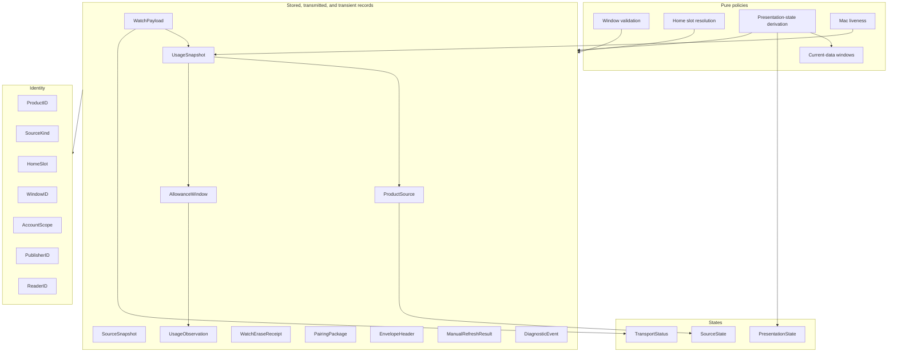

# Domain module

Status: Proposal

`ResetRadarDomain` is the innermost layer of the [software architecture](../architecture.md). It holds the entities, value types, and pure policies every other module shares, and knows nothing about storage, networking, operating-system services, or presentation.

## Position

| Property | Value |
|---|---|
| Layer | Entities, the innermost layer |
| Platforms | iOS, macOS, watchOS |
| Depends on | Foundation only |
| Used by | Every module and composition root |

Rules:

- No import beyond Foundation; no file, network, Keychain, or system-service access.
- No hidden inputs. The current time arrives as a `Date` argument, and random values arrive as arguments, so every policy is deterministic.
- Types are value types and `Sendable`. Persisted or transmitted types are also `Codable` and schema-versioned.
- No global or mutable shared state.

## Internal architecture

Records reference identities; policies read records and produce states. Nothing in this module calls outward.

## Wire conventions

All persisted and transported records are `Codable`, `Sendable`, and explicitly schema-versioned. Enum wire values are stable lowerCamelCase strings that match the code-facing names in [ux-terms.md](../ux-terms.md). An unknown value in an optional field decodes to an explicit `unknown` case without discarding the record.

Validation is per window. An invalid percentage, timestamp, or duration rejects that window's observation and produces a redacted `DiagnosticEvent`, while valid windows in the same snapshot are kept. An unknown mandatory schema version rejects the whole record.

## Identity

| Type | Rule |
|---|---|
| `ProductID` | Closed set: `codex` and `claudeCode`. Windows for an unknown product are ignored with a diagnostic. |
| `SourceKind` | `codexAppServer` or `claudeCodeStatusLine`. |
| `HomeSlot` | Closed set: `codexFiveHour`, `codexWeekly`, `claudeCodeFiveHour`, and `claudeCodeWeekly`. The stable key for Home cells, widget and complication configuration, App Intent parameters, notification opt-in, and Live Activities. |
| `WindowID` | Composite of product, account scope when available, provider limit ID, and duration discriminator; never an array position. It identifies one concrete provider window and changes when the account scope changes. |
| `AccountScope` | Codex only: an opaque 128-bit value. How it is derived is defined in [Transport](transport.md#account-scope); the domain only compares it. Claude Code exposes no account identifier, so its windows carry no scope. |
| `PublisherID` | Random 256-bit identifier for one Mac/relay relationship. |
| `ReaderID` | Random opaque identifier for one paired iPhone or iPad. |

## Records

`UsageSnapshot`, the unit the Mac publishes:

- `schemaVersion`;
- `publisherID`;
- `generatedAt`, the Mac assembly time;
- `heartbeatSeconds`, the publication heartbeat the Mac keeps while running;
- one `ProductSource` per product, with source kind, source version, and source state;
- an open-ended array of `AllowanceWindow`; and
- optional redacted compatibility diagnostics.
- up to twelve recent `ManualRefreshResult`s, at most four per registered reader, encrypted with the snapshot and retained for two minutes after the Mac handles a request.

`SourceSnapshot` is the normalized result of one Mac source read or source-state transition. It carries one `ProductSource`, that product's reported windows, and whether the source returned a complete report or only a state change. A source failure or missing Claude Code rate-limit data does not mean zero usage or erase the preceding observations. `CollectUsage` uses a complete report to mark absent windows as retained, and a state-only result to change source status without advancing `observedAt`.

`ManualRefreshResult` holds the requesting `ReaderID`, a random 128-bit request ID, completion time, and `codexRead` or `sourceUnavailable`. It is authenticated inside the encrypted snapshot. `codexRead` means an app-server read completed after the Mac received the request, even if the reported values did not change. `sourceUnavailable` means the Mac attempted the read but it failed; neither result claims that Claude Code refreshed. The relay sees only the opaque request ID and cannot forge a result.

`AllowanceWindow`:

- `id`, product, provider `limitID`, optional provider label, and optional duration minutes;
- `isDefaultLimit`, true for windows in Codex's backward-compatible default bucket and for Claude Code's account-level windows;
- `reportState`, either `reported` or `retained`;
- optional absolute `resetsAt`;
- optional latest `UsageObservation`; and
- optional provider limit state, such as Codex reached state or `ordinaryUsageAllowed`, kept separate from percentage.

`UsageObservation`:

- validated finite `usedPercent` in the closed range `0...100`;
- `observedAt`, the Mac time of the provider reading as the source adapter defines it, never replaced by publication or receipt time;
- source version; and
- optional precision metadata for presentation rounding: Codex reports integers, Claude Code up to one decimal.

The model never stores remaining percentage, fixed five-hour or weekly fields on a product, recurrence rules, or observation history.

Other records:

| Record | Contents |
|---|---|
| `WatchPayload` | Schema version, iPhone installation ID, strictly increasing delivery revision, optional committed `UsageSnapshot` and relay sequence, `TransportStatus`, last relay-contact and commit times, and a `cleared` flag used by Forget Mac. A cleared payload has no snapshot. |
| `WatchEraseReceipt` | Schema version, iPhone installation ID, and the delivery revision of a cleared payload durably committed on the Watch. It contains no usage or relay secret. A receipt confirms cache erasure and a complication reload request, not immediate removal of an already rendered complication frame. |
| `PairingPackage` | Schema version, relay endpoint, `ReaderID`, read token, content key, publisher ID, key version, minimum acceptable sequence, and relay-assigned registration expiry. Encoding is defined in [Transport](transport.md#pairing-package-codec). |
| `EnvelopeHeader` | Protocol version, envelope version, publisher ID, sequence, and key version: the authenticated outer metadata of a relay envelope. |
| `DiagnosticEvent` | Category, state enums, durations, sequence ranges, versions, HTTP status class, and timestamps. Its initializers accept no free-form strings, so redaction holds by construction. |

## Home slot resolution

A `HomeSlot` resolves to the one window with its product, `isDefaultLimit` set, and an exact duration of 300 minutes (five-hour) or 10,080 minutes (weekly). Claude Code's `five_hour` and `seven_day` kinds carry those durations by their documented names; no other duration is ever inferred. No match yields an unavailable cell. More than one match also yields an unavailable cell, plus a diagnostic. Every other window appears in Usage Details and diagnostics without taking a Home slot.

## Availability

Availability has independent inputs, so the passage of time never depends on a device that may be asleep or offline.

**Source state** is written by the Mac for each product: `reporting`, `unavailable` (not installed or not set up), `signedOut`, `sourceOffline` (the source cannot start or keeps exiting), or `incompatible`.

**Presentation state** is derived for each window from the snapshot, the product's current-data window, and a `now` argument. It is never serialized. The first matching rule wins:

1. `unavailable`: the window has no observation, or it is `retained` and has no reset instant or its last known reset has passed. The old observation remains in diagnostics but is not presented as a ring value.
2. `resetAwaitingRefresh`: `resetsAt` is at or before `now`. No percentage is presented and none is fabricated; the observation remains available for diagnostics.
3. `stale`: any of these holds:
   - the product's source state is not `reporting`;
   - the window is `retained`;
   - `observedAt` is older than the current-data window;
   - `observedAt` is more than five minutes after `now`.

   The last percentage is presented with a stale treatment and the reason.
4. `current`: none of the above.

The derivation also returns the next instant at which its result would change, so widget, complication, and Live Activity timelines can place an entry at each threshold.

**Current-data windows** are per-product constants: fifteen minutes for Codex and sixty minutes for Claude Code. Both are candidates until source calibration confirms them; see [Source calibration](../architecture.md#source-calibration).

**Mac liveness** is derived from `generatedAt` and `heartbeatSeconds`. The Mac counts as not publishing once `generatedAt` is older than three heartbeats. Liveness affects provenance only; a recent heartbeat never makes an old observation current.

**Transport status** is device-local: `notPaired`, `awaitingFirstPublish`, `current`, `offline`, `authorizationRequired`, `quotaLimited`, `invalidSnapshot`, `incompatible`, or `secretsUnavailable`. A relay outage does not rewrite source state, and a fresh relay receipt does not make an old observation current.

## Tests

`ResetRadarDomainTests` covers:

- `0`, fractional, `100`, NaN, infinite, and out-of-range percentages, each rejected per window;
- unknown enum values and unknown mandatory schema versions;
- Home slot resolution, including the ambiguous case of two default windows with the same duration;
- the presentation-state precedence at each threshold crossing, including a retained Home window after its last reset, the next-change instant, and clock skew;
- manual-refresh result validation, per-reader retention cap, expiry, and wrong-reader matching;
- Mac liveness; and
- OS-local rendering inputs for fixed instants across time zones.
