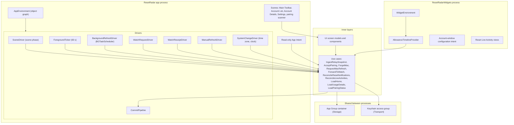

# iOS app

Status: Active

The iOS app is a composition root of the [software architecture](../architecture.md): the universal `ResetRadar` app for iPhone and iPad, its `ResetRadarWidgets` extension, and its App Intents. It wires the adapters to the [Application](application.md) use cases and turns system events into use-case calls. It contains no product rules of its own.

## Position

| Property | Value |
|---|---|
| Layer | Composition root (frameworks and drivers) |
| Targets | `ResetRadar` (iPhone and iPad device families) and `ResetRadarWidgets` (WidgetKit extension) |
| App imports | [Domain](domain.md), [Application](application.md), [Storage](storage.md), [Transport](transport.md), [Scheduling](scheduling.md), [WatchSync](watch-sync.md), and [UI](ui.md) |
| Widget imports | Domain, Application, Storage, Transport, Scheduling, and UI |

Rules:

- Each process builds its object graph once, in one environment type, and injects ports into use cases and use cases into screen models.
- Drivers translate events into use-case calls and carry no policy. Cadences and thresholds come from `ReaderRefreshPolicy` and the Domain policies.
- The widget extension reconciles opted-in reset notifications after a committed ingest, without requesting authorization. It flags `needsAppReconcile` for any unfinished notification work, Live Activities, and Watch delivery.

## Internal architecture

## Process model

The app and the widget extension are separate processes that share two things:

- the App Group container, through [Storage](storage.md); and
- the Keychain access group, through [Transport](transport.md#secret-store).

Both can run `IngestRelaySnapshot`. `ReaderStore` serializes their claims and commits with a cross-process lock, and the snapshot commit is a compare-and-swap on sequence, so neither can roll the other back. Each process wires `ReaderStore` and `SnapshotStore` to facades over the same atomic `ReaderBundle` file; a lock alone would not make two separate file replacements crash atomic.

iOS may terminate a process that is suspended while it holds a lock on a file in a shared container. The lock is therefore held only for the claim and the commit, never across a network request. Each locked section also runs inside a short background-execution assertion: a `UIApplication` background task in the app, and an expiring activity in the extension. The section either finishes or is abandoned without the lock before suspension. Device validation covers suspension and expiry mid-commit.

`CommitPipeline` runs only in the app process. After a commit made by the app, it:

1. reloads widget timelines;
2. reconciles reset notifications;
3. reconciles Live Activities; and
4. forwards the payload to the Watch.

When the widget process commits, it reconciles opted-in reset notifications before completing the
timeline request and sets `needsAppReconcile`. The app retries unfinished notification work and
runs the Live Activity and Watch stages the next time it executes for any reason. An app-side
reconciliation failure also keeps durable work pending. The marker clears only after all required
stages succeed for the still-current snapshot; a newer commit or failed state write preserves it.
The widget never starts a Live Activity or opens a Watch session.

`WatchReceiptDriver` consumes typed `WatchEraseReceipt`s from `WatchLink` and calls `ConfirmWatchErase`. On launch and Watch-session activation, the app resends a saved pending clear before offering a newer Watch payload. A pairing completed while erasure is pending can refresh the iPhone cache, but its Watch delivery waits for the receipt. The Pairing & Sync screen distinguishes interrupted local cleanup from local Forget Mac completion and pending or confirmed cache erasure on a responding Watch. It does not claim to erase another paired Watch.

## Composition

`ReaderComposition.live()` builds one `ReaderDependencies` value, and `ReaderEnvironment` turns it
into the app's single object graph. The environment also acts as the scene driver, foreground
ticker, and manual-refresh driver.

- **Storage root.** Release requires the shared App Group container and fails closed with an
  installation error when it is missing. Development uses the `Debug` storage flavor and the debug
  Keychain service, so it never reads an installed app's data. Development builds are unsigned,
  so on a simulator they have no App Group entitlement. They then fall back to the app's own
  Application Support directory, still with the `Debug` flavor. Release never falls back. The
  owner approved this fallback on 2026-10-26.
- **Keychain group.** The access group comes from the entitlement-expanded
  `ResetRadarKeychainAccessGroup` Info.plist value. An unexpanded or foreign value fails closed
  rather than falling back to the default group.
- **Transactions.** `BackgroundTaskReaderStore` wraps each `ReaderStore` transaction in a
  `UIApplication` background task. Reads and the network work between a claim and its commit run
  outside it.
- **Launch.** Activation first removes staged secrets left by a crash. It retries Forget Mac
  cleanup only when that cleanup is marked pending, because an unmarked retry would treat an
  intact pairing as an unfinished forget. It then resumes a pending activation, reloads, runs the
  foreground ingest, and starts the ticker. Overlapping activations share one run, so a launch
  sends at most one activation request.
- **Leaving the foreground.** The ticker stops at its next sleep. A visible Refresh wait ends at a
  sleep boundary through the manual-refresh clock. An in-flight relay read always completes,
  because cancelling it would be recorded as an offline relay with backoff. The saved request
  marker stays, so a later Refresh within the deadline resumes the wait without posting again.
- **Post-commit hand-off.** Until their drivers exist, the widget reloader, notification, and Live
  Activity stages of the after-commit pipeline are inert. Without a `WatchLink`, a Forget Mac clear
  stays pending; the app never reports a Watch as erased without its receipt.
- **Test launches.** Development builds also recognize `-ResetRadarSyntheticScenario <name>`, which
  selects an isolated temporary store, in-memory secrets, and an in-process relay that seals
  synthetic snapshots with the real envelope cipher. A hosted unit-test launch builds no live graph.
  Release builds contain neither mode.

## Refresh drivers

| Driver | Event | Use-case call |
|---|---|---|
| `SceneDriver` | A scene becomes active | `IngestRelaySnapshot(.foregroundActivation)` |
| `ForegroundTicker` | Every 60 seconds while any scene is active; cancelled when none is | `IngestRelaySnapshot(.foregroundTick)` |
| Refresh action | The user pulls to refresh or taps Refresh | Home Refresh ingests the relay, posts one `allCodex` request, and waits for its encrypted per-account result. A Codex Account Details action follows the same flow for that account ID. A Claude Code Account Details action calls `IngestRelaySnapshot(.manual)` only. |
| `BackgroundRefreshDriver` | `BGAppRefreshTask` | `IngestRelaySnapshot(.backgroundTask)`, then the pipeline |
| `WatchRequestDriver` | A Watch refresh request wakes the app | `IngestRelaySnapshot(.watchRequest)`, then a `ForwardToWatch` reply |
| `AllowanceTimelineProvider` | WidgetKit asks for a timeline | `IngestRelaySnapshot(.widgetReload)`, then the exact-window `LoadUsageDetails` or medium-widget `LoadHome` query |
| `SystemChangeDriver` | Time-zone or significant clock change | `ReconcileResetNotifications`, then a screen reload |

`ReaderRefreshPolicy` decides whether each call actually fetches; see [Policies](application.md#policies).

**Watch requests.** A Watch request wakes the app with very little background time. `WatchRequestDriver` holds a background task for the whole request. It runs the ingest with the client's 10-second request timeout, and always completes the reply, with the committed payload when the fetch fails, before WatchConnectivity's message timeout.

**Manual Mac refresh.** `ManualRefreshDriver` runs only for a visible user action while the scene is active. It presents relay contact and Mac completion as separate outcomes. It cancels the 45-second wait if the scene leaves the foreground, without reposting the same request. A matching result in a later normal ingest still updates the cache, but does not retroactively claim that the cancelled action completed. The widget, background task, App Intent, and Watch request never post a manual Codex request.

**Background task:**

- **Registration.** One identifier is registered at launch and listed under `BGTaskSchedulerPermittedIdentifiers`.
- **Requests.** Exactly one request stays pending. It is resubmitted when the app moves to the background and at the end of every run, with the earliest begin date the policy computes; that date pulls toward just after the next reset.
- **Expiry.** The expiration handler cancels the ingest.
- **Completion.** The task is always completed, with success only when ingest finished without a transport failure.
- **Assumption.** The design assumes the system may never run the task.

## Scenes and navigation

[ux-gui.md](../ux-gui.md), [ux-information-architecture.md](../ux-information-architecture.md), and [ux-terms.md](../ux-terms.md) are authoritative for destinations, order, placement, icons, and copy.

- **Root.** One root tab container is presented as the Main Toolbar on iPhone. On iPad it uses the system's adaptive tab bar or sidebar presentation, with the same five destinations in the same order.
- **Navigation.** Each destination owns its navigation stack. On iPhone, Home's Account List
  pushes Account Details; on iPad it remains in a split view with Account Details. All pushes
  Settings.
- **Setup Banner.** Derived from pairing and transport status.
- **Pairing.** The pairing scanner uses the camera, with a manual paste fallback, and calls `AcceptPairing`. It shows `awaitingActivation` while the saved pairing's confirmation is retried; an expired or revoked registration returns to setup and requires a fresh package.
- **Reader visibility.** Home and Account Details use `VisibleSnapshot` through `LoadHome` and `LoadUsageDetails`; pairing and cleanup state comes from `LoadPairingStatus`. The app cannot infer Mac account configuration before its first authenticated publication. An empty reader therefore shows pairing, activation, or first-publication guidance as appropriate, without inventing account rows. A preflight snapshot remains hidden until activation. A later relay failure preserves visible committed rows with their actual freshness and transport status.
- **Selection.** iPad persists only an `AccountID` for its local Home selection. On each committed snapshot, it keeps that ID if present, otherwise selects the first account in `LoadHome` order; an empty list clears the selection. A ring carries an optional initial window focus into the same Account Details destination, without changing the selected account identity.
- **Live Activities.** Start Live Activity appears only where ActivityKit reports activities as enabled, which excludes iPad.

## Widget extension

**Timelines.** `AllowanceTimelineProvider` serves the `systemSmall` Home Screen and
`accessoryRectangular` Lock Screen widgets, configured by an all-window `WindowSelection` intent,
and the `systemMedium` Home Screen widget, configured for one account and both standard windows.
The widget configuration intent and its dynamic window picker read only the committed cache. The
intent is distinct from the read-only usage App Intent below. For each timeline it:

1. runs `IngestRelaySnapshot(.widgetReload)` with the client's 10-second request timeout, reconciles opted-in notifications after a commit within the extension's remaining execution time, and continues with the committed cache if the call is skipped or fails;
2. reads the exact selected window through `LoadUsageDetails` or an equivalent committed-cache
   query for small/Lock Screen widgets, or `LoadHome` for the medium widget. A missing additional
   window is unavailable and resumes only if the exact `WindowID` returns; and
3. emits an entry now and at known presentation changes, always including a known reset or
   invalidation boundary. It avoids dense entries when possible, then requests the next reload at
   the earlier of the next change instant and fifteen minutes from now. This is an earliest
   request, not a guarantee that WidgetKit renders or runs exactly on time.

Countdowns use dynamic dates, so they move between entries.

**Live Activity.** The extension also hosts the Reset Live Activity's Lock Screen and Dynamic Island views. They use `ResetActivityAttributes`, system timer text that stops at zero, and the `isStale` presentation; see [Scheduling](scheduling.md#reset-live-activity).

## App Intent

The read-only intent takes one all-window `WindowSelection`. It returns percentage used when
current, the absolute reset time when available, source, observation time, and presentation state.
It reads only the committed cache through `LoadUsageDetails` or an equivalent query and never triggers a
relay or provider refresh. A missing additional `WindowID` stays unavailable until that exact ID
returns; the intent never selects a different provider window.

## Configuration

| Item | Value |
|---|---|
| Device families | iPhone and iPad |
| App Group | One identifier, shared by the app and the widget extension. It is also the Keychain access group. |
| Background | The `fetch` background mode and one permitted Background Tasks identifier. |
| Live Activities | `NSSupportsLiveActivities` on the app. |
| Privacy strings | Camera usage description for QR pairing. |
| Watch | Embedded Watch app (see [Watch app](watch-app.md)). |
| Excluded | No Push Notifications, iCloud, CloudKit, or analytics entitlement. |

## Tests

- **`ResetRadarTests`:** composition and fail-closed storage and Keychain resolution; transaction
  background assertions; pairing preview, confirmation, preflight, lost and rejected activation,
  local-save failure, staging recovery, and Forget-first re-pairing; strictly newer commits,
  offline and unverifiable envelopes, unexpected `304`, locked secrets, and an independent store
  instance's lease; Forget Mac erasure, pending Watch clear, retryable cleanup, and late results;
  iPad selection; and Home, Codex account, and Claude Code Refresh, including the 45-second wait
  and leaving the foreground. The widget process, background task, App Intent, timelines, and
  Watch receipt handling are tested with their drivers.
- **`ResetRadarUITests`:** the Main Toolbar, natural alias ordering, unavailable and waiting rings,
  row and ring navigation, every Account Details window, setup and sync states, Refresh results,
  Settings routes, Forget Mac, cleanup retry, Watch-erasure status, iPad split selection, and
  accessibility text sizes. They run on both simulator destinations in
  [Platform targets](../architecture.md#platform-targets), using the synthetic scenarios.
