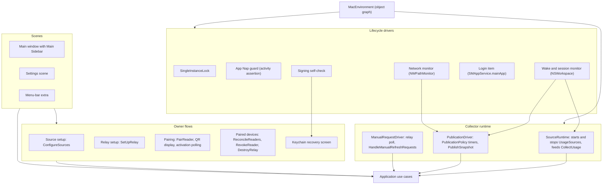

# Mac app

Status: Active

The Mac app is the collector's composition root in the [software architecture](../architecture.md). `ResetRadarMac` runs the provider sources and is the only publisher to the relay. It also hosts the Mac interface and the menu-bar companion, and installs the `ResetRadarStatusLine` helper. It wires adapters to the [Application](application.md) use cases, and owns process lifecycle, signing, and Keychain access.

## Position

| Property | Value |
|---|---|
| Layer | Composition root (frameworks and drivers) |
| Targets | `ResetRadarMac`, with `ResetRadarStatusLine` embedded in its helpers directory (see [ProviderAdapters](provider-adapters.md#helper-composition)) |
| Imports | [Domain](domain.md), [Application](application.md), [Storage](storage.md), [Transport](transport.md), [ProviderAdapters](provider-adapters.md), and [UI](ui.md) |

Rules:

- One object graph per process, built in `MacEnvironment`.
- Drivers translate system events into use-case calls and carry no policy. Collection timing is in `CodexSchedule`; publication timing is in `PublicationPolicy`.
- The collector, publisher, and notification scheduler belong to the application, not to any window.

## Internal architecture

## Process posture

- **No App Sandbox, Hardened Runtime on.** The app launches the user's installed `codex` executable and reads the helper's files in Application Support. Outbound HTTPS to the relay is its only network use; that is a design rule enforced in code review, because no sandbox entitlement enforces it.
- **One instance per storage namespace.** `SingleInstanceLock` holds an exclusive lock beside the publisher state in Application Support. A second instance using that same state activates the first and exits, so two collectors never publish against one sequence. Debug builds use their separate data directory and relay secrets, so they can run beside the installed app without sharing publisher state.
- **App Nap.** While collecting, `AppNapGuard` holds a process activity that disables App Nap but still allows idle system sleep, so the poll and heartbeat timers aren't throttled when no window is visible. Timers carry a 10% tolerance. Validation measures their drift with the window closed.
- **Sleep and wake.** Nothing runs during sleep. On wake, `WakeMonitor` triggers an immediate source refresh and publication.
- **Network.** When the path becomes satisfied after a failure, `NetworkMonitor` triggers an immediate publication instead of waiting for backoff.

## Signing and Keychain

The Mac app must never show a Keychain prompt.

**Why ad-hoc signing breaks Keychain access.** Login-keychain items trust the app that created them, identified by its designated requirement (a code-signing rule) and team. An ad-hoc build ("Sign to Run Locally") has a designated requirement equal to its own code hash and no team, so every rebuild is a different app to the keychain, and access requires a dialog.

**Contract.**

1. **One identity.** Every Release build of `ResetRadarMac` and `ResetRadarStatusLine` is signed with the owner's Personal Team Apple Development identity. Its designated requirement names the bundle identifier and the certificate, so rebuilds and manual updates keep Keychain access.
2. **Build check.** In the Release configuration, a check inspects the signed app and fails the build when it has no team identifier, which rejects ad-hoc signing before the binary can touch the Keychain. Development builds are not signed with the identity and skip the check. A script phase runs before code signing, so the check is the `ResetRadarMac` scheme's build post-action, which sees the signed app and its embedded helper.
3. **No provisioning profile.** The app uses no entitlement that requires one, so nothing expires weekly. Secrets therefore live in the file-based login keychain (see [Transport](transport.md#secret-store)).
4. **Non-interactive access.** Every Keychain call runs with user interaction disabled. Secrets are read once per launch and kept in memory.
5. **Separation from development.** Development builds use a separate Keychain service and data directory, and tests use the in-memory `SecretStore`, so neither development nor the gate touches the installed app's items.

**Failure handling.** At launch, `SigningCheck` compares the running signature's team identifier with the one recorded at relay setup.

- **`interactionRequired`.** A Keychain read that fails this way pauses publication with `secretsUnavailable`. The app retries every minute and when the login session becomes active, which covers a temporarily locked keychain.
- **Later Keychain lock.** After a successful launch read, `SessionSecretCache` holds the relay secrets in the running process. A later login-Keychain lock does not pause publication; quit, Destroy Relay, or setup replacement clears that process cache. The relay Settings and recovery copy state this explicitly, so a user does not mistake Keychain lock for a publishing stop.
- **Recovery screen.** If the read still fails, or the team identifier changed, Settings shows the recovery screen. It explains the two causes, a locked keychain or a changed signing identity, and offers two remedies: rebuild with the recorded identity, or run relay setup and re-pair. The app never prompts and never silently generates new secrets.

## Collector runtime

- **Sources.** `SourceRuntime` starts each configured `UsageSource` after launch, routes their update streams into `CollectUsage`, and forwards `wake`, `foreground`, and `manual` refresh reasons.
  A failed Release signing check leaves source startup paused so no source can read relay
  secrets. Activating a replacement relay rebuilds the collector and rechecks signing before
  sources resume.
- **Publication.** `PublicationDriver` arms one timer for the instant `PublicationPolicy` next allows, and calls `PublishSnapshot` when it fires or when a `transition` change arrives. It forwards changed blocked outcomes from ordinary and manual-request publication to the session-local Global Messages Pane, preserving the `StopReason` category but never forwarding raw relay responses or secrets; it reports recovery after a later successful publish.
- **Home updates.** After `CollectUsage` commits a source report, the composition root forwards its
  snapshot to the process-owned Home model on the main actor. Alias edits from Home or Sources
  reload both view models. The account list and selected details refresh while the window stays
  open; accounts use the shared localized display order.
- **Home usage rows.** Each configured account resolves its default five-hour and weekly windows
  by account ID and duration. A presentable reading shows provider-reported Percentage Used in
  its ring; stale readings keep the value with a status symbol, while waiting and unavailable
  windows show no percentage. The row reevaluates presentation as time advances.
- **Mac account details.** The Main Sidebar keeps Home's Account List beside the selected account.
  Home persists a valid local selection, shows the next source, relay, or pairing setup action,
  and allows all-source Refresh. The Account Details pane shows both standard windows followed by
  other valid provider windows, with provider-reported Percentage Used, Reset Time, Last Updated,
  availability explanations, provenance, and account-scoped Refresh. The selected Home ring
  emphasizes its Window Details section. The process-owned Home model also supplies account
  status to the menu bar when Settings opens before the main window.
- **Manual reader requests.** While collection and relay setup are active and at least one reader is paired, `ManualRequestDriver` polls the relay every 15 seconds for pending IDs, coalesces them through `HandleManualRefreshRequests`, and publishes their encrypted result immediately. Polling stops with no readers, or during setup, destruction, or `secretsUnavailable`. A sleeping Mac cannot receive or satisfy a request; the driver resumes on wake. The result is acknowledged at the relay only after publication succeeds.
- **Reader readiness.** Pairing confirmation, roster reconciliation, revocation, relay activation,
  and destruction refresh the manual-request driver's local reader state. Sleep changes only its
  sleep state, so wake cannot re-enable polling after relay or reader state changes. Setup and
  destruction suspend polling before changing relay state.
- **Relay lifecycle.** Setup and destruction persist a non-active lifecycle state and pause `PublicationDriver` before any credential or remote-state change. A pending setup is recoverable after an interrupted provisioning step; publication resumes only after the new publisher binds. A failed or interrupted remote destroy leaves publication paused and the prior local state available for an explicit retry.
- **Notifications.** M12 exposes a post-commit `ResetNotificationHook` seam but starts no
  notification driver, requests no permission, and does not import
  `UNUserNotificationCenter`. P1-M15 owns `NotificationDriver` and reset notifications.
- **Quit.** Stops sources and publication cleanly and releases the instance lock.

## Local troubleshooting log

The Mac composition root writes structured JSON Lines for startup, collector lifecycle, changed
publication blocks and recovery, and redacted diagnostics. A log line has a UTC timestamp, a
per-launch session ID, a fixed event name, and only applicable typed reason, transport, HTTP
status class, schema, or sequence fields. It never includes account IDs, provider names,
aliases, home or executable paths, usage values, tokens, provider responses, or raw error text.
This is the agent-facing root-cause trail; the existing diagnostics ring remains the in-app
summary. `LogDiagnosticsSink` receives the build-specific OSLog subsystem and forwards typed
events to the Mac log. The same build-specific subsystem is used for the Mac log's generic write
failure notice.

Development writes to `~/Library/Logs/ResetRadar.dev/`; Release writes to
`~/Library/Logs/ResetRadar/`. These paths are outside the app bundle and readable by coding
agents running under the owner's macOS account. The directories are `0700` and the files `0600`.
Files are named `events-YYYY-MM-DD-N.jsonl` in UTC. The logger holds only the current UTC day
and seven previous days, rotates at 1 MiB, keeps at most four segments per day, and prunes at
startup, on writes, and at UTC midnight. File creation rejects symlinks and unsafe ownership or
permissions; writes are locked across processes. Critical startup and publication blocks are
synced. If the directory is unsafe or unavailable, the app still runs and emits an OSLog
write-failure category without raw error text. Diagnostics Settings displays the active log
directory.

## Owner flows

| Flow | Behavior |
|---|---|
| Source setup | Sources Settings has a Codex card with an Alias/Home Folder table and an Add row for up to two accounts, plus a Claude Code card that directly edits the default Claude Code user settings file after exact preview and confirmation. The Mac rejects a Codex Home Folder with surrounding whitespace or a missing directory, then passes the selected `CODEX_HOME` and current user's login shell to discovery so a safe executable outside standard Homebrew paths can be offered. A configured Codex row can replace its Home Folder through the same exact preview and confirmation while retaining its account identity and alias. Both products use `ConfigureSources`; removal requires confirmation, and aliases are editable from Home or Sources. A confirmed add, replacement, removal, or Claude Code restore rebuilds the collector immediately from the persisted catalog. Normal launch and preview prepare the verified Claude Code helper; a blocked preview distinguishes helper failure from an unprovable existing command. The narrow trusted `bash $HOME/<script>` form can be composed; other unsafe existing commands remain untouched. |
| Relay setup | Show the provisioning digests for copy; then wipe and bind through `SetUpRelay`. |
| Pairing | Show the QR package, poll reader activation every five seconds while visible, hide it only after the reader confirms its local save, and revoke at the relay-assigned expiry. Manual Copy is a separate warned action with conditional pasteboard cleanup; QR is the default. |
| Paired devices | List names, pairing dates, and unknown readers; Revoke; Destroy Relay. |
| Keychain recovery | As described under "Signing and Keychain". |

## Scenes

[ux-gui.md](../ux-gui.md) and [ux-information-architecture.md](../ux-information-architecture.md) are authoritative.

- **Main window.** Contains the Main Sidebar. Home uses a split Account List and Account Details
  view; the list restores its last valid selection and permits inline alias editing. A shared
  Global Messages Pane occupies the bottom of the detail column, to the right of the sidebar.
  Its minimum size is 1,400 by 900 points; overflowing detail text wraps.
- **Settings.** The standard Settings scene, opened with Command-comma, with General, Sources,
  Relay & Pairing, Diagnostics, and About. The same Global Messages history appears below every
  Settings detail section, to the right of the sidebar. Its minimum size is 1,300 by 800 points;
  overflow in the detail pane wraps rather than truncating. The sidebar stays visible at that
  size, and opening Settings directly triggers the same idempotent collector startup as the main
  window.
- **Menu-bar extra.** Shows one five-hour and weekly status line per configured account, followed
  by Refresh All, Open Reset Radar, Settings, and Quit. Open Reset Radar targets the main window;
  closing it leaves the collector running. The menu shows the last successful publication time
  or an attention state after a blocked attempt. Ordinary refresh feedback does not hide the
  per-account status lines.
  The open menu reevaluates each reading every 30 seconds so staleness and reset transitions
  appear without a new source report.
- **Login launch.** Starts the menu-bar extra without bringing the main window forward.

## Installation and lifecycle

**Installation.** The app is built locally under the signing contract above, without notarization or an automatic updater. Installation instructions cover:

- creating the Apple Development identity in Xcode;
- Gatekeeper approval for the locally built app, and first launch;
- Codex discovery and the Claude Code guided setup;
- relay deployment and setup, then pairing; and
- optional launch at login.

**Login item.** `SMAppService.mainApp` backs an explicit launch-at-login toggle, shown during setup and in General Settings. The UI reflects registration status and errors; it never claims success from the requested toggle alone.

**Update.** A manual update replaces only the application bundle, preserving Application Support and Keychain state; the unchanged signing identity keeps Keychain access. Before accepting a newer local cache schema, [Storage](storage.md#migration) writes a recoverable backup. There is no in-app binary downloader.

**Uninstall.** Instructions distinguish removing the app bundle from destroying relay data and Keychain items. The preferred flow is:

1. Destroy Relay.
2. Disable launch at login.
3. Restore the prior Claude Code status-line setting from its restore record, if requested.
4. Remove the installed status-line helper copy and its session files.
5. Erase local data and the app's Keychain items.
6. Quit, and remove the app.

Recovery documentation covers a missing app, a lost Mac, a rejected login item, an incompatible CLI, a changed signing identity, and a locked keychain.

## Configuration

| Item | Value |
|---|---|
| Deployment target | macOS 26.7.1 (see [Platform targets](../architecture.md#platform-targets)) |
| App Sandbox | Off |
| Hardened Runtime | On |
| Entitlements | None that require a provisioning profile |
| Signing | Personal Team Apple Development identity for every Release build, enforced by the build check; Development builds are unsigned |
| Helper | `ResetRadarStatusLine`, a command-line target embedded in the app bundle's helpers directory |

## Tests

`ResetRadarMacTests` covers:

- the single-instance lock;
- wake and network-restore publication;
- manual-request polling, coalescing, rate limit, result publication before acknowledgement, and sleep/wake handling;
- `PublicationDriver` timer arming against the policy;
- signing-check and recovery routing, using an injected signature reader;
- setup/destroy interruption and relaunch with publication still paused;
- the `secretsUnavailable` retry; and
- status-line helper integration with a synthetic Claude Code payload.

The real Keychain, App Nap behavior, and the login item are proven on the reference Mac, never by the gate; see [Platform behavior](../architecture.md#platform-behavior-to-be-proven-on-real-runtimes).
