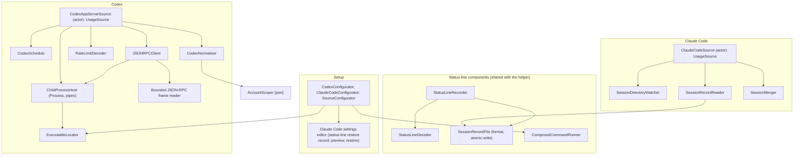

# ProviderAdapters module

Status: Active

`ResetRadarProviderAdapters` is the macOS source adapter of the [software architecture](../architecture.md). It reads Codex and Claude Code allowance state through their first-party surfaces and normalizes it into `SourceSnapshot`s. It also contains the status-line components that the `ResetRadarStatusLine` helper runs inside Claude Code.

## Position

| Property | Value |
|---|---|
| Layer | Adapter |
| Platforms | macOS only |
| Depends on | [Domain](domain.md), [Application](application.md), and Foundation |
| Implements | `UsageSource` for each product, and `SourceConfigurator` |
| Consumes | `AccountScoper`, injected by the Mac app and implemented by [Transport](transport.md#account-scope) |
| Used by | The [Mac app](mac-app.md) and the `ResetRadarStatusLine` helper, both composition roots |

Rules:

- Never opens provider authentication files or intentionally collects credentials, prompts, responses, or project paths. Codex JSON-RPC responses and Claude Code status-line input are necessarily decoded in memory; only the allowlisted usage fields below may cross into a stored record or diagnostic. Raw input is never logged or persisted.
- Never imports another adapter. The account scope arrives through the injected `AccountScoper` port, and session files are written with Foundation's atomic write.
- Owns source-specific timing, such as Codex polling. Product-level publication timing belongs to [Application](application.md#policies).

## Internal architecture

## Codex app-server

**Discovery.** A login item starts with a minimal `PATH`, and an npm-installed `codex` is a Node script that also needs `node`. `CodexConfigurator` therefore resolves the executable once, with the owner present, trying in order:

1. a path the owner chose;
2. `command -v codex` in the owner's login shell;
3. the standard Homebrew locations.

It records the absolute path, plus the login shell's `PATH` and `CODEX_HOME` when set, and the owner confirms the result in Sources settings. `ChildProcessHost` launches the child with only those variables plus `HOME`, `USER`, and `LANG`. Discovery never reads authentication files.

**Lifecycle.** `CodexAppServerSource` starts one long-lived `codex app-server --listen stdio://` child, completes the initialization handshake, and calls `account/rateLimits/read`. The child's standard error is drained and discarded in bounded chunks, never accumulated or logged. The source restarts the child when the resolved executable's version or modification time changes, so an upgraded Codex is never read through an old process. Closing standard input on quit or collector crash ends the child; source calibration confirms this.

`BoundedRPCFrame` reads newline-delimited standard output incrementally. It rejects an unterminated payload as soon as it exceeds 1 MiB and rejects a completed payload over 1 MiB before JSON decoding; the delimiter is not part of that count. Structural preflight caps a decoded object key or string value at 4 KiB of UTF-8, nesting at 32 levels, multi-bucket entries at 128, and decoded rate-limit windows at 128. A missing delimiter cannot grow a buffer without limit. An over-limit frame terminates that child, maps to a typed malformed/incompatible source outcome, preserves the last valid observation, and enters restart backoff. Raw bytes and rejected fields are never logged. Source calibration checks that legitimate installed-version responses fit these limits; a legitimate over-limit result returns the bound to review rather than silently truncating windows.

**Reads.** `RateLimitDecoder` decodes both the compatibility bucket and `rateLimitsByLimitId`. `CodexNormalizer`:

- classifies windows by duration and limit identity rather than primary/secondary position;
- marks windows of the compatibility bucket's limit as `isDefaultLimit`; and
- obtains the account scope through `AccountScoper`.

`observedAt` is the Mac time a successful read response arrived.

**`CodexSchedule`:**

| Trigger | Rule |
|---|---|
| Poll | Every five minutes while the collector runs. |
| `account/rateLimits/updated` notification | Read at most once per 60 seconds. The payload is sparse, so the source always refetches instead of merging it. |
| Known `resetsAt` | One read 30 seconds after each reset instant in the latest report. |
| `wake`, `foreground`, `manual` | An immediate read, coalesced with any read in flight; never parallel processes. |
| Authenticated manual relay request | An immediate read when the Mac is awake, coalesced across pending reader IDs and limited to one remote-forced read every 30 seconds. Its result is handled by `HandleManualRefreshRequests`; it never invokes Claude Code. |
| Request timeout | 10 seconds. |
| Restart backoff | One, two, five, then fifteen minutes maximum. |

The candidate current-data window is fifteen minutes; source calibration must confirm it.

## Claude Code status line

**Installation.** The Mac app embeds `ResetRadarStatusLine` and copies it to `~/Library/Application Support/ResetRadar/bin/reset-radar-statusline`. It refreshes the copy on launch when its version differs and reports a mismatch in Settings. Claude Code settings reference that stable copy, not a path inside the app bundle, so a manual app update cannot break the command. Because the path contains a space, the recorded command is the quoted absolute path.

**Guided setup.** `ClaudeCodeConfigurator` is owner-confirmed. It detects the current settings and Claude Code version, presents the exact change, stores only the prior `statusLine` setting in an owner-only, timestamped restore record, and modifies that setting only after confirmation. It never makes a whole-settings backup, because unrelated settings may contain secrets. An atomic settings update preserves every unrelated field without exporting it to Reset Radar's storage or diagnostics. Restore changes only the `statusLine` setting back, leaving unrelated later edits intact.

When a status-line command already exists, the configurator first parses it without invoking a shell. Automatic composition accepts only a single executable path, either absolute or beginning with `~/` for owner-home expansion, with no arguments, environment assignments, other variable expansion, redirection, pipe, or shell operator. The resolved file must be an existing executable owned by the user or installed in a trusted system location. Any command that contains an inline token or whose shape cannot be proved safe is left untouched, and setup explains that automatic composition is unavailable. For an accepted command, the helper's `statusline-compose.json` stores only the resolved executable path, never a shell string. The installer runs the original executable and the composed helper against a synthetic payload and installs only if their visible output matches. The restore record is likewise written only after this safety check. If validation fails, Claude Code remains unavailable and the existing command is untouched.

### Helper composition

`ResetRadarStatusLine` is a composition root that imports Domain and this module only. On each invocation it wires:

1. **`StatusLineDecoder`** reads standard input up to a fixed size bound. It extracts only `version`, `session_id`, `cost.total_api_duration_ms`, and each `rate_limits` window's `used_percentage` and `resets_at` (Unix seconds). It ignores `spend_limit`, which describes a managed gateway spend limit, can exceed 100%, and carries dollar amounts. It keeps unknown window kinds with percentage and reset only.
2. **`StatusLineRecorder`** applies the observation-time and dropped-window rules below.
3. **`SessionRecordFile`** writes `claude-status/<session key>.json`, where the session key is a truncated SHA-256 of `session_id`. The write is an owner-only atomic replacement.
4. **`ComposedCommandRunner`** launches the validated executable directly with `Process`, without a shell or additional arguments, using the identical input bytes and forwarding its output and exit status. Otherwise the helper prints nothing.

The helper never touches the network or Keychain, and never persists any other input field.

### Observation time

Claude Code reruns the status line on interface events that bring no new API response, and its input carries no observation timestamp. [Claude Code's status-line documentation](https://code.claude.com/docs/en/statusline) says subscriber `rate_limits` first appears after an API response. `StatusLineRecorder` therefore advances a window's `observedAt` to the current time only in two cases:

- the session's `cost.total_api_duration_ms` increased; or
- the window first appears in a session after that session previously had no rate-limit reading.

Otherwise it keeps the earlier `observedAt`. A percentage or reset change alone does not prove a new API response, because Claude Code may alter cached window state on an idle rerun. If the activity field is absent after the first reading, subsequent changes stay stale until another response signal is validated. Source calibration must confirm that the activity field advances on every API response and holds steady on idle reruns; failure returns the freshness rule to the owner.

### Dropped windows

Claude Code drops a window from its input once the window's reset passes, and `rate_limits` is absent before a session's first API response. A window missing from the input keeps its prior entry, marked `retained`; after its last known reset, its Home slot becomes unavailable while the old entry remains available to diagnostics. A missing `rate_limits` object never erases earlier entries.

### Collection

`ClaudeCodeSource` reads the session directory:

- **Isolation.** Each concurrent Claude Code session writes only its own file, so an idle session cannot overwrite newer data from an active one.
- **Watching.** `SessionDirectoryWatcher` watches the directory rather than individual files, because atomic replacement swaps a file out from under a file-level watch. It coalesces events over two seconds, and the source also rescans on foreground and manual refresh.
- **Merging.** `SessionMerger` uses, for each window kind, the entry with the newest `observedAt`. It deletes session files whose newest observation is more than eight days old.
- **No forced refresh.** The source never creates a Claude turn to obtain newer state.

The candidate current-data window is sixty minutes from `observedAt`; source calibration must confirm it independently from Codex.

## Errors and logging

Errors are typed as not-installed, signed-out, incompatible, timeout, process-exited, malformed, permission-denied, or temporarily-unavailable, and map to the product's source state. Diagnostics record event category, source version, timing, and error class only.

## Tests

`ResetRadarProviderAdaptersTests` covers:

- **Codex:**
  - compatibility bucket and multiple limit IDs, including two same-duration limits with only the default bucket marked;
  - sparse update and the 60-second notification limit;
  - the reset-triggered read;
  - missing duration or reset;
  - signed-out or error response;
  - reached and permission state;
  - malformed percentage;
  - timeout and process exit;
  - completed and unterminated oversized JSON-RPC payloads, missing framing, excessive nesting, bucket/window counts, duplicate keys, and bounded stderr draining;
  - discovery with a missing `node` and with an owner-chosen path; and
  - restart after the executable changes.
- **Claude Code:**
  - five-hour and seven-day payloads;
  - missing or empty `rate_limits`, and a dropped window kept as `retained`;
  - `spend_limit` ignored and never persisted;
  - unknown kind;
  - malformed or future timestamp;
  - first appearance, an idle rerun or value-only change that keeps `observedAt`, and an activity increase that advances it;
  - two concurrent sessions;
  - pruning;
  - composition with an existing command and a path containing a space;
  - refusal of arguments, inline assignments, shell syntax, and secret-bearing or unparseable existing commands without changing Claude Code settings or creating a restore record;
  - status-line-only restore that preserves unrelated settings edits;
  - helper-copy version mismatch;
  - atomic partial-write rejection; and
  - status-line-only restore record and restore.

Fixtures are synthetic; no real account data is checked in.
