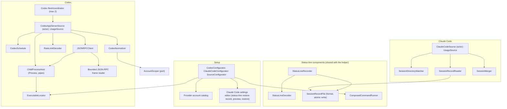

# ProviderAdapters module

Status: Active

`ResetRadarProviderAdapters` is the macOS source adapter of the [software architecture](../architecture.md). It reads Codex and Claude Code allowance state through their first-party surfaces and normalizes it into `SourceSnapshot`s. It also contains the status-line components that the `ResetRadarStatusLine` helper runs inside Claude Code.

## Position

| Property | Value |
|---|---|
| Layer | Adapter |
| Platforms | macOS only |
| Depends on | [Domain](domain.md), [Application](application.md), Foundation, Darwin for file, lock, and process primitives, and CryptoKit for the 128-bit Claude Code session key and content digests |
| Implements | One account-scoped `UsageSource` per configured account, `SourceConfigurator`, and the account catalog |
| Consumes | `AccountScoper`, injected by the Mac app and implemented by [Transport](transport.md#account-scope) |
| Used by | The [Mac app](mac-app.md) and the `ResetRadarStatusLine` helper, both composition roots |

Rules:

- Never opens provider authentication files or intentionally collects credentials, prompts, responses, or project paths. Codex JSON-RPC responses and Claude Code status-line input are necessarily decoded in memory; only the allowlisted usage fields below may cross into a stored record or diagnostic. Raw input is never logged or persisted.
- Never imports another adapter. The account scope arrives through the injected `AccountScoper` port. Codex and Claude Code code may share neutral primitives inside this module (structural JSON preflight, owner-only locked files), but not provider-specific types.
- Owns source-specific timing, such as Codex polling. Product-level publication timing belongs to [Application](application.md#policies).

## Internal architecture

## Codex app-server

**Discovery.** A login item starts with a minimal `PATH`, and an npm-installed `codex` is a Node
script that also needs `node`. `CodexConfigurator` resolves each of at most two selected profiles,
with the owner present, trying in order:

1. a path the owner chose;
2. `command -v codex` in the owner's login shell;
3. the standard Homebrew locations.

For each selection it records the absolute path, applicable interpreter identity, and confirmed
`HOME`, `USER`, `LANG`, `PATH`, and optional `CODEX_HOME`. The owner confirms the exact preview in
Sources settings. `ChildProcessHost` launches that account's child with only those values.
Discovery never reads authentication files, and runtime never consults `codex-profile` or an
ambient selector.

**Lifecycle.** The fleet starts one isolated, long-lived
`codex app-server --listen stdio://` child per configured account, concurrently. Each source
completes initialization, calls structured `account/read` with `refreshToken: false`, and then
calls `account/rateLimits/read`. Standard error is drained and discarded in bounded chunks, never
accumulated or logged. A source independently restarts after its executable/interpreter version or
modification identity changes. Closing standard input on quit or collector crash ends both
children; source calibration confirms this.

`BoundedRPCFrame` reads newline-delimited standard output incrementally. It rejects an unterminated
payload as soon as it exceeds 1 MiB and rejects a completed payload over 1 MiB before JSON decode.
LF terminates a frame; one immediately preceding CR forms a CRLF delimiter, and neither terminator
byte counts toward the payload cap. A standalone CR remains payload. Structural preflight caps a
decoded object key or string value at 4 KiB of UTF-8, nesting at 32 levels, multi-bucket entries at
128, and decoded rate-limit windows at 128. A missing delimiter cannot grow a buffer without limit.
An over-limit or malformed frame terminates that child, maps to `incompatible`, and preserves the
last valid observation without repeatedly restarting unchanged input. Raw bytes and rejected
fields are never logged. Source calibration checks that legitimate installed-version responses fit
these limits; a legitimate over-limit result returns the bound to review rather than silently
truncating windows.

`JSONRPCClient` uses monotonically increasing positive integer request IDs through `2^53 - 1` and
refuses exhaustion instead of reusing an ID.

### Account status

`account/read` is decoded structurally before the first rate-limit read and after a rate-limit RPC
error that could represent authentication. These are the only outcomes:

| Decoded status | Outcome |
|---|---|
| Supported ChatGPT account and a boolean `requiresOpenaiAuth` of either value | Authenticated; continue to the rate-limit read. The installed Codex reports `true` for a signed-in ChatGPT account because the flag describes the provider, so account presence is the discriminator. |
| Null account and `requiresOpenaiAuth == true` | `signedOut`; retain applicable prior windows and do not infer anything from error prose. |
| Any other well-formed combination, including a non-ChatGPT account | `incompatible`; API-key mode and ambiguous authentication state are outside scope. |
| Missing method, missing or wrong-typed discriminator, or incompatible result shape | `incompatible`. |
| Timeout, process/pipe exit, or a typed temporary RPC failure | `sourceOffline` under the retry matrix below. |

After a generic rate-limit RPC error, a repeated status read may prove only the signed-out case.
When it instead proves an authenticated supported account, the adapter classifies the original
error from its machine-readable JSON-RPC code. Standard parse, invalid-request, method-not-found,
and invalid-params codes (`-32700`, `-32600`, `-32601`, `-32602`) are incompatible. Internal error
(`-32603`) and reserved server errors (`-32099...-32000`) are temporarily source-offline. Every
other code is incompatible. It never inspects or retains the provider message.

**Reads.** `RateLimitDecoder` decodes both the compatibility bucket and `rateLimitsByLimitId`. `CodexNormalizer`:

- classifies windows by duration and limit identity rather than primary/secondary position;
- marks windows of the compatibility bucket's limit as `isDefaultLimit`; and
- requires a provider account identifier, obtains its opaque scope through `AccountScoper`, and
  stamps the separate local `AccountID` on every window.

The fleet rejects two configured profiles that resolve to the same provider scope. The lower
global account number remains active; the other row becomes incompatible. A provider-scope change
retains the local row ID, number, and alias while clearing only that row's old-scope windows.

`observedAt` is the Mac time a successful read response arrived.

**`CodexSchedule`:**

| Trigger | Rule |
|---|---|
| Poll | Every five minutes while the collector runs. |
| `account/rateLimits/updated` notification | Read at most once per 60 seconds. The payload is sparse, so the source always refetches instead of merging it. |
| Known `resetsAt` | One read 30 seconds after each reset instant in the latest report. |
| `wake`, `foreground`, `manual` | Read immediately when no restart backoff is active and coalesce with any read in flight; otherwise return a deferred receipt. Never create parallel processes. |
| Authenticated manual relay request | Read the one opaque account target or all configured Codex accounts, coalescing within each source. Active backoff returns an immediate deferred receipt and is never bypassed. Results remain per account; it never invokes Claude Code. |
| Request timeout | 10 seconds. |
| Restart backoff | One, two, five, then fifteen minutes maximum. |

### Source states and retry

The adapter emits one enum-backed diagnostic and at most one state-only report per failed physical
attempt. State-only reports preserve prior windows except for a proven account-scope transition or
duplicate-scope eviction.

| Failure class | Source state | Automatic behavior |
|---|---|---|
| Not configured; configured executable absent; launch configuration or file permissions unsafe | `unavailable` | Do not launch or enter restart backoff. Re-evaluate after an owner configuration or executable change. |
| Structurally proven signed-out status | `signedOut` | Keep the healthy child when possible; recheck status on the normal five-minute poll and explicit refresh triggers. Do not use restart backoff solely for sign-out. |
| Unsupported method or schema; ambiguous account status; missing account/limit identity; framing, JSON, bound, or normalization violation | `incompatible` | Terminate the affected session and wait for a configuration or executable-version change. Repeated manual refresh does not relaunch unchanged incompatible input. |
| Request timeout; process or pipe exit; typed temporary backend failure; `AccountScoper` failure | `sourceOffline` | Terminate the affected session when needed and retry after 1, 2, 5, then 15 minutes; later failures remain at 15 minutes until one complete success resets the ladder. Explicit triggers respect the active deadline. |
| Duplicate provider scope on the higher-numbered row | `incompatible` | Keep the lower-numbered row active. Re-evaluate only after relevant configuration or provider-scope state changes. |

`ordinaryUsageDisallowed` and `reached` describe a successfully read allowance bucket; neither is a
source failure and neither enters this matrix.

The current-data window is fifteen minutes, confirmed by the 2026-10-25 two-profile source calibration.

## Claude Code status line

**Installation.** The Mac app embeds `ResetRadarStatusLine` and copies it to `~/Library/Application Support/ResetRadar/bin/reset-radar-statusline`. It refreshes the copy on launch when its version differs and reports a mismatch in Settings. Claude Code settings reference that stable copy, not a path inside the app bundle, so a manual app update cannot break the command. Because the path contains a space, the recorded command is the quoted absolute path.

**Guided setup.** `ClaudeCodeConfigurator` is owner-confirmed. It detects the current settings,
presents the exact change, stores only the prior `statusLine` setting in an owner-only,
timestamped restore record, and modifies that setting only after confirmation. Setup neither
invokes Claude Code nor probes its installed version. Each status-line observation supplies its
actual public Claude Code version, which stays attached to that observation through recording and
merging. It never makes a whole-settings backup, because unrelated settings may contain secrets.
An atomic settings update preserves every unrelated field without exporting it to Reset Radar's
storage or diagnostics. Restore changes only the `statusLine` setting back, leaving unrelated
later edits intact.

When a status-line command already exists, the configurator first parses it without invoking a shell. Automatic composition accepts only a single executable path, either absolute or beginning with `~/` for owner-home expansion, with no arguments, environment assignments, other variable expansion, redirection, pipe, or shell operator. The resolved file must be an existing regular executable owned by the user inside the owner's home directory, with every ancestor owned by the user or root and not writable by group or other; system-installed and root-owned executables are not composed. Any command that contains an inline token or whose shape cannot be proved safe is left untouched, and setup explains that automatic composition is unavailable. For an accepted command, the helper's `statusline-compose.json` stores only the resolved executable path, never a shell string. The installer runs the original executable and the composed helper against a synthetic payload and installs only if their visible output matches. The restore record is likewise written only after this safety check. If validation fails, Claude Code remains unavailable and the existing command is untouched.

### Helper composition

`ResetRadarStatusLine` is a composition root that imports Domain and this module only. On each invocation it wires:

1. **`StatusLineDecoder`** reads standard input up to a fixed size bound. It extracts only `version`, `session_id`, `cost.total_api_duration_ms`, and each `rate_limits` window's `used_percentage` and `resets_at` (Unix seconds). It ignores `spend_limit`, which describes a managed gateway spend limit, can exceed 100%, and carries dollar amounts. It keeps unknown window kinds with percentage and reset only.
2. **`StatusLineRecorder`** applies the observation-time and dropped-window rules below.
3. **`SessionRecordFile`** writes `claude-status/<session key>.json`, where the session key is a truncated SHA-256 of `session_id`. The write is an owner-only atomic replacement.
4. **`ComposedCommandRunner`** launches the validated executable directly with `Process`, without a shell or additional arguments, using the identical input bytes and forwarding its output and exit status. Otherwise the helper prints nothing.

The helper never touches the network or Keychain, and never persists any other input field.

### Observation time

Claude Code reruns the status line on interface events that bring no new API response, and its input carries no observation timestamp. [Claude Code's status-line documentation](https://code.claude.com/docs/en/statusline) says subscriber `rate_limits` first appears after an API response. `StatusLineRecorder` therefore advances a window's `observedAt` to the current time only in two cases:

- the session's `cost.total_api_duration_ms` increased; or
- the window first appears in a session after that session previously had no rate-limit reading.

Otherwise it keeps the earlier `observedAt`. A percentage or reset change alone does not prove a
new API response, because Claude Code may alter cached window state on an idle rerun. If the
activity field is absent after the first reading, subsequent changes stay stale until another
response signal is validated. Owner-present source calibration on 2026-10-25 confirmed that the
activity field advances after responses and holds steady across timer-driven idle reruns and
another session's activity.

### Dropped windows

Claude Code drops a window from its input once the window's reset passes, and `rate_limits` is absent before a session's first API response. A window missing from the input keeps its prior entry, marked `retained`; after its last known reset, its standard Account Row ring becomes unavailable while the old entry remains available to diagnostics. A missing `rate_limits` object never erases earlier entries.

### Collection

`ClaudeCodeSource` reads the session directory:

- **Isolation.** Each concurrent Claude Code session writes only its own file, so an idle session cannot overwrite newer data from an active one.
- **Watching.** `SessionDirectoryWatcher` watches the directory rather than individual files, because atomic replacement swaps a file out from under a file-level watch. It coalesces events over two seconds, and the source also rescans on foreground and manual refresh.
- **Merging.** `SessionMerger` uses, for each window kind, the entry with the newest `observedAt`. It deletes session files whose newest observation is more than eight days old.
- **No forced refresh.** The source never creates a Claude turn to obtain newer state.

**Account row.** Claude Code has one account row in the account catalog, created when the owner confirms guided setup. `ClaudeCodeSource` stamps that row's `AccountID` on every window it reports. Claude Code exposes no provider account identifier, so its windows and `AccountSource` carry no `AccountScope`, and the helper never reads the catalog or learns an `AccountID`. The row keeps its global number and alias across a restore and reinstall; removal is a separate confirmed action.

The current-data window is sixty minutes from `observedAt`, confirmed independently from Codex by
the 2026-10-25 owner-present source calibration.

## Errors and logging

Errors are typed as not-installed, signed-out (Codex only; status-line data cannot prove it), incompatible, timeout, process-exited, malformed,
permission-denied, account-scope failure, duplicate provider scope, or temporarily-unavailable and
map to the affected account's source state. Diagnostics record only enum-backed event category, product and
source kind, timing, and error class. The bounded public source version remains on `AccountSource`;
diagnostics accept no provider string.

## Tests

`ResetRadarProviderAdaptersTests` covers:

- **Codex:**
  - compatibility bucket and multiple limit IDs, including two same-duration limits with only the default bucket marked;
  - sparse update and the 60-second notification limit;
  - the reset-triggered read;
  - missing duration or reset;
  - signed-out or error response;
  - reached and permission state;
  - malformed percentage;
  - timeout and process exit;
  - exact account-status combinations and every source-state/retry-matrix row;
  - completed and unterminated oversized JSON-RPC payloads, LF and CRLF framing, missing framing,
    excessive nesting, bucket/window counts, duplicate keys, request-ID exhaustion, and bounded
    stderr draining;
  - discovery with a missing `node` and with an owner-chosen path; and
  - restart after the executable changes.
- **Claude Code:**
  - five-hour and seven-day payloads;
  - missing or empty `rate_limits`, and a dropped window kept as `retained`;
  - `spend_limit` ignored and never persisted;
  - unknown kind;
  - malformed or future timestamp;
  - first appearance, an idle rerun or value-only change that keeps `observedAt`, and an activity increase that advances it;
  - two concurrent sessions;
  - pruning;
  - composition with an existing command and a path containing a space;
  - refusal of arguments, inline assignments, shell syntax, and secret-bearing or unparseable existing commands without changing Claude Code settings or creating a restore record;
  - status-line-only restore that preserves unrelated settings edits;
  - helper-copy version mismatch;
  - atomic partial-write rejection; and
  - status-line-only restore record and restore.

Fixtures are synthetic; no real account data is checked in.
