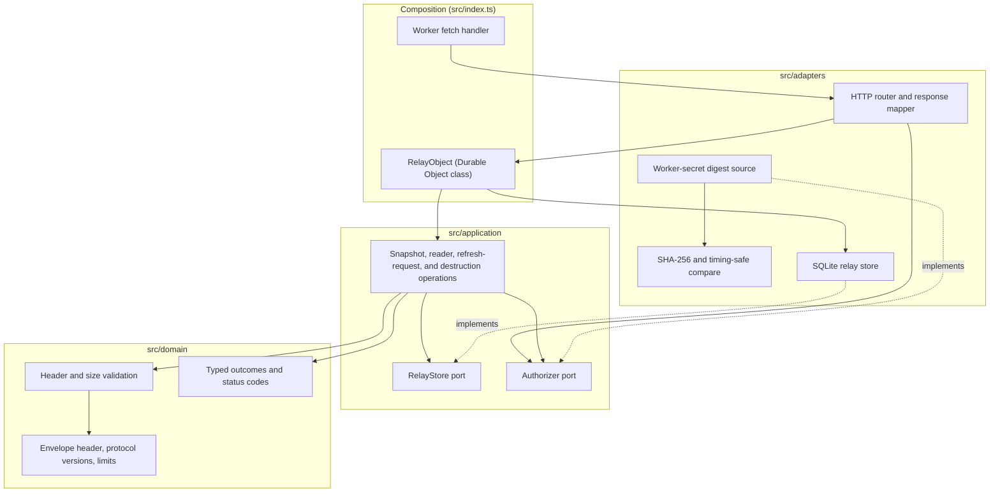

# Relay module

Status: Proposal

The relay is the Cloudflare part of the [software architecture](../architecture.md): a single-tenant Worker and one SQLite-backed Durable Object on `workers.dev`. It stores the latest encrypted envelope, enforces authority and ordering, and cannot decrypt anything. This document is the canonical relay protocol for both the Worker and the Swift [Transport](transport.md) client.

## Position

| Property | Value |
|---|---|
| Package | `relay/`, independent of the Swift package |
| Toolchain | Strict TypeScript, npm, Wrangler, and Workers Vitest support |
| Runtime | Workers Free, one Worker, one SQLite-backed Durable Object addressed by a fixed name |
| Shares with Swift | Checked-in JSON protocol fixtures only, never executable source |

## Internal architecture

The package applies the same dependency rule as the Swift code: `domain` and `application` have no Cloudflare imports, and only `adapters` and the entry point touch the runtime.

## Protocol

| Operation | Authority | Contract |
|---|---|---|
| `PUT /v1/snapshot` | Write token | Accept at most 64 KiB. On empty storage, bind the envelope's publisher ID and sequence. Otherwise atomically reject an unexpected publisher, an equal or lower sequence, malformed outer metadata, or an unsupported mandatory version. Return the sequence and a strong ETag. |
| `GET /v1/snapshot` | Any registered read token | Authenticate a pending reader's preflight without activating it. Return the latest envelope with `Cache-Control: no-store`, support `If-None-Match`, and return not-found before the first publish. |
| `POST /v1/readers/activate` | Registered read token | Derive `ReaderID` from the token and idempotently mark that reader activated after the client has saved its pairing locally. Return `200` even if already activated. Reject an expired or revoked pending reader with `401`; never accept a reader ID supplied in the body. |
| `POST /v1/refresh-requests` | Activated read token | Accept a client-generated random 128-bit request ID for a Codex read in a body capped at 128 bytes. Store at most one pending request per reader for 60 seconds. Repeating the same ID while pending returns the same `202` and expiry without a new request; repeating the last completed ID returns `409`; a different ID inside the reader's 60-second rate limit returns `429`. Return `202` and the relay-assigned expiry for a new request. The request carries no usage value, account data, or provider credential. |
| `GET /v1/refresh-requests` | Write token | Return at most three unexpired request IDs with their `ReaderID`s and relay-assigned expiry, using `Cache-Control: no-store`. Reading does not consume a request, so a Mac crash cannot lose it. |
| `DELETE /v1/refresh-requests/{id}` | Write token | Remove a request after the Mac has successfully published its encrypted result. A duplicate delete is idempotent. Expiry also removes a request. |
| `PUT /v1/readers/{id}` | Administration token | Register a pending reader's token digest with a relay-assigned five-minute expiry and return that expiry in UTC; reject a fourth registered reader. `{id}` is a random `ReaderID` chosen by the Mac. Expired pending rows are removed before enforcing the cap. |
| `GET /v1/readers` | Administration token | List registered reader IDs and whether each is activated, with no times or other metadata. |
| `DELETE /v1/readers/{id}` | Administration token | Revoke one reader. |
| `DELETE /v1/relay` | Administration token | After trusted local confirmation, atomically delete all Durable Object storage. Repeating the request after an interrupted client cleanup succeeds even when storage is already empty. |

### Responses

| Response | Cause | Client behavior |
|---|---|---|
| `200` | Snapshot accepted or returned; reader registered or list complete; refresh-request list complete; activation confirmed | The Mac records publication or the registration deadline; a reader validates and commits, or clears its local `awaitingActivation` marker. |
| `202` | Manual refresh request accepted | The reader waits for a matching encrypted result for at most 45 seconds. |
| `204` | Refresh request deleted or already absent | The Mac may forget the completed pending ID. |
| `304` | `If-None-Match` matched on an authenticated snapshot read | Update relay-contact time only when the reader still has the validated snapshot associated with that ETag; otherwise retry once without the condition. |
| Other `3xx` | Unexpected redirect | The client treats it as a protocol failure and never sends its token to the redirected location. The relay does not intentionally issue redirects. |
| `400` | Malformed request or outer metadata | Stop automatic retry and record a diagnostic. |
| `401` | Missing, unknown, revoked, or wrong-authority token | `authorizationRequired`; stop automatic retry and require re-pairing. |
| `404` | Authenticated `GET /v1/snapshot` before the first publish | `awaitingFirstPublish`. An unknown route is a protocol error, never an empty first snapshot. |
| `409` | Publisher mismatch, sequence not greater, reader cap reached, or a completed manual request ID replayed | The Mac stops automatic publication and offers setup and re-pairing for a snapshot conflict, or reports the reader cap. A reader reports a completed-ID replay as a rejected manual action without changing its cache. |
| `413` | Body over 64 KiB | The Mac stops publication and records a diagnostic. |
| `422` | Unsupported mandatory protocol or envelope version | `incompatible`; requires an update. |
| `429` or platform quota error | Free daily limit or manual-request rate limit | The reader keeps its valid cache. A manual-request `429` reports that another request is pending or recently accepted; a platform quota error sets `quotaLimited` and backs off. |
| `5xx`, network, or TLS failure | Worker, Durable Object, or connectivity failure | `offline`; back off with jitter. |

Error bodies are generic, at most 4 KiB, and never reveal whether a token, publisher, or reader exists. Snapshot responses stay within the 64 KiB upload limit. Other successful response bodies are at most 4 KiB. The relay never intentionally redirects. Relay conformance records the exact response Cloudflare returns at the Free daily limit; platform-generated quota responses may need a separately bounded client mapping.

### Authentication

- **Where tokens are checked.** The Worker checks write and administration tokens against Worker-secret digests before calling the Durable Object. Read tokens are checked inside the Durable Object against stored digests: an invalid read token causes a lookup but never a write. Only an authenticated, activated reader may create a refresh request; revocation deletes its pending request in the same transaction. A pending reader may only preflight-read a snapshot or activate itself before its relay-assigned deadline.
- **Order of checks.** Authentication precedes body parsing beyond the size check.
- **Comparison.** Presented-token digests use constant-time comparison.
- **Where tokens never appear.** URLs, configuration variables, response bodies, source, logs, or command-line arguments.

## State

The Durable Object's SQLite database has three tables:

| Table | Columns |
|---|---|
| `relay_state` (one row) | Latest envelope, its ETag and accepted time, bound publisher ID, last sequence, and protocol-state version. |
| `readers` (at most three rows) | Reader ID, token digest, activated flag, pending expiry, last accepted manual-refresh time, and last accepted request ID for duplicate and rate-limit checks. |
| `refresh_requests` (at most three live rows) | Reader ID, opaque request ID, and relay-assigned accepted and expiry times. Expired rows are removed during request operations; no alarm is needed. Deleting a completed request does not reset the rate limit in `readers`. |

There is no product history. Each operation deletes expired unactivated readers before other reader work; expiry cannot revoke an already activated reader. The write and administration digests live as Worker secrets, not in the database. Cloudflare point-in-time recovery may retain provider-managed historical storage for its documented period, so deletion copy cannot promise immediate physical erasure from backups.

## Operations

- **Cost contract.** Workers Free with no paid add-on. Logs, traces, Logpush, and unused bindings are disabled. The route fails closed at the Free limits.
- **No idle work.** No WebSockets or alarms, so the object idles between requests.
- **Manual refresh bounds.** A reader can cause at most one accepted request per 60 seconds. The Mac polls the request list every 15 seconds while collecting, and the reader polls the snapshot every five seconds for no more than 45 seconds. The Mac independently limits remote-forced Codex reads to one per 30 seconds. Rejected or unauthenticated requests cannot trigger a source read. The Free-tier capacity calculation includes even repeated manual actions at these limits.
- **Pinned build.** A compatibility date and a tested Wrangler version.
- **Releases.** Immutable versions, smoke-tested on a version URL with synthetic ciphertext, then promoted. Rollback never assumes a storage rollback.
- **Scripts.** `npm test` runs Workers Vitest; `npm run typecheck` runs `tsc --noEmit`. A provisioning script reads the write and administration digests from standard input and writes them as Worker secrets without echoing them.

## Tests

The relay tests cover:

- operation authority, including token crossover between roles;
- size and version validation;
- publisher binding on empty storage;
- strict ordering;
- ETags and conditional reads;
- an unknown route versus an authenticated first-publish `404`, and `304` only for an existing snapshot;
- reader register, preflight read without activation, activation after local-save acknowledgement, idempotent activation retry even after a lost response and displayed expiry, pending expiry, list, revoke, and cap;
- manual-request authentication, duplicate and last-completed-ID replay, per-reader rate limit, three-reader cap, expiry, revocation, Mac polling without consumption, idempotent acknowledgement, and no request survival after relay destruction;
- deletion, including repetition after a client-side interruption;
- every row of the response table; and
- response-size ceilings and no intentional redirect;
- fixture parity with the Swift [Transport](transport.md#tests) tests.

Deployed behavior and capacity are proven by [Relay conformance](../architecture.md#relay-conformance).
