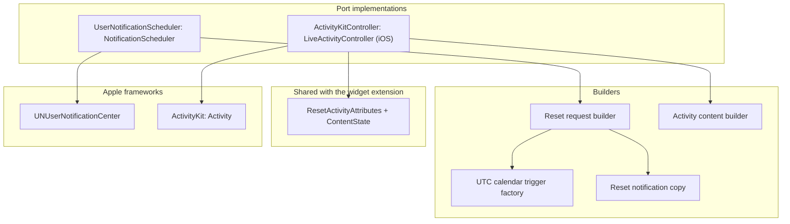

# Scheduling module

Status: Active

`ResetRadarScheduling` is the system-scheduling adapter of the [software architecture](../architecture.md). It turns the [Application](application.md) notification and Live Activity decisions into UserNotifications requests and ActivityKit activities. It also owns the activity attributes shared with the iOS widget extension.

## Position

| Property | Value |
|---|---|
| Layer | Adapter |
| Platforms | iOS and macOS; the ActivityKit part compiles only on iOS |
| Depends on | [Domain](domain.md), [Application](application.md), UserNotifications, and ActivityKit on iOS |
| Implements | `NotificationScheduler`, plus `LiveActivityController` on iOS |
| Provides | `ResetActivityAttributes` for Live Activity views |
| Used by | Composition roots: the iOS app, its widget extension, and the Mac app |

Rules:

- Executes, never decides. Which requests and activities should exist, and their content and `staleDate`, come from `ReconcileResetNotifications` and `ReconcileLiveActivities`.
- Never imports another adapter, and reads no files or relay state.

## Internal architecture

## Reset notifications

- **Identifier.** Each request's identifier is derived from its `HomeSlot`, so scheduling the same slot again replaces the earlier request instead of adding one.
- **Trigger.** Non-repeating `UNCalendarNotificationTrigger` whose date components carry an explicit UTC time zone, so the absolute fire instant stays fixed when the device's time zone changes.
- **Copy.** Names the product and window and says it has reset. It never embeds a formatted local time or a percentage.
- **Authorization.** The scheduler reports `notDetermined`, `denied`, `authorized`, or `provisional`, and requests authorization only when a use case asks.
- **Scope.** On iOS, the app requests authorization when the owner enables a slot; the widget extension may only reconcile already opted-in requests after a cache commit. Apple's [`UNUserNotificationCenter` documentation](https://developer.apple.com/documentation/usernotifications/unusernotificationcenter) includes app extensions; the widget-specific behavior remains a physical-device spike. On macOS the same scheduler runs in the Mac app process. The Watch has no scheduler; it shows forwarded iPhone notifications.

## Reset Live Activity

`ResetActivityAttributes` holds the static `HomeSlot` and `WindowID`. Its `ContentState` holds percentage used, `observedAt`, `resetsAt`, the product source state, and the precision for rounding.

`ActivityKitController` does the following:

- **Start.** Requests an activity with `pushType: nil`. It is called only from a foreground Usage Details action.
- **Update.** Sends `ActivityContent` with the `staleDate` the use case computed.
- **End.** Uses immediate dismissal.
- **Availability.** Reports activities as unavailable when ActivityKit says they are disabled. iPad never reports them as available.

The Lock Screen and Dynamic Island views live in the [iOS widget extension](ios-app.md#widget-extension). They render the countdown with system timer text over the interval ending at `resetsAt`, so it keeps advancing without app execution and stops at zero, and they use `isStale` to show the stale presentation.

## Tests

`ResetRadarSchedulingTests` covers:

- request identifiers, UTC trigger components across time-zone changes, and copy that never contains a formatted time or a percentage;
- authorization-state mapping; and
- activity content and attribute encoding.

Real delivery, the eight-hour activity limit, and stale display are proven on devices; see [Platform behavior](../architecture.md#platform-behavior-to-be-proven-on-real-runtimes).
