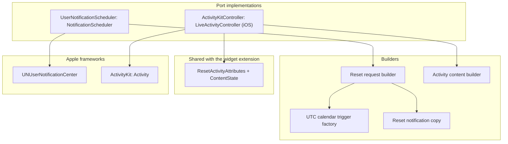

# Scheduling module

Status: Active

`ResetRadarScheduling` is the system-scheduling adapter of the [software architecture](../architecture.md). It turns the [Application](application.md) notification and Live Activity decisions into UserNotifications requests and ActivityKit activities. It also owns the activity attributes shared with the iOS widget extension.

## Position

| Property | Value |
|---|---|
| Layer | Adapter |
| Platforms | iOS and macOS; the ActivityKit part compiles only on iOS |
| Depends on | [Domain](domain.md), [Application](application.md), UserNotifications, and ActivityKit on iOS |
| Implements | `NotificationScheduler`, plus `LiveActivityController` on iOS |
| Provides | `ResetActivityAttributes` for Live Activity views |
| Used by | Composition roots: the iOS app, its widget extension, and the Mac app |

Rules:

- Executes, never decides. Which requests and activities should exist, and their content and `staleDate`, come from `ReconcileResetNotifications` and `ReconcileLiveActivities`.
- Never imports another adapter, and reads no files or relay state.

## Internal architecture

## Reset notifications

- **Identifier and ownership.** Legacy standard-window identifiers stay unchanged. An additional
  selection uses a versioned Reset Radar prefix plus a bounded deterministic digest of the
  selection's canonical identity, so scheduling the same window replaces its prior request and a
  changed provider scope cannot inherit it. Versioned, non-secret selection metadata also travels
  in `userInfo`; the digest is not treated as reversible. The scheduler separately lists supported
  typed requests and every identifier under the exact owned prefix. Reconciliation removes
  malformed owned requests but never touches an unrelated app notification.
- **Trigger.** Non-repeating `UNCalendarNotificationTrigger` whose date components carry an explicit UTC time zone, so the absolute fire instant stays fixed when the device's time zone changes.
- **Copy.** Names the displayed alias, product, and window and says it has reset. It never embeds a
  formatted local time or a percentage. A changed alias or window label replaces pending copy
  even when the fire instant is unchanged; Application supplies these display fields.
- **Authorization.** The scheduler reports `notDetermined`, `denied`, `authorized`, `provisional`,
  a framework failure, or a future-unknown status, and requests authorization only when a use case
  asks. Provisional authorization delivers quietly and is displayed as provisional. Failure and
  future-unknown are neither denial nor permission to prompt again.
- **Presentation.** Reset requests use the default notification sound. The app delegate presents
  a banner while Reset Radar is foreground-active on iPhone, iPad, or Mac when authorization is
  fully granted. Provisional authorization retains the system's quiet-delivery behavior.
- **Scope.** On iOS, the app requests authorization when the owner enables an account window; the widget extension may only reconcile already opted-in requests after a cache commit. Apple's [`UNUserNotificationCenter` documentation](https://developer.apple.com/documentation/usernotifications/unusernotificationcenter) includes app extensions; the widget-specific behavior remains a physical-device spike. On macOS the same scheduler runs in the Mac app process. The Watch has no scheduler; it shows forwarded iPhone notifications.
- **Confirmation and capacity.** Adds and removals are followed by a pending-request read-back.
  An add/remove/read error, a missing desired request, or an owned request that remains after
  removal is retryable. The framework's removal call has no completion result, so Forget Mac also
  requires a clean read-back before local cleanup completes. If the valid source set exceeds what
  a reference OS retains, the implementation fails its evidence gate and returns to the owner
  instead of silently prioritizing windows.

## Reset Live Activity

`ResetActivityAttributes` holds the static `AccountWindow`, `WindowID`, and `startedAt`. Its
`ContentState` holds the displayed alias, percentage used, `observedAt`, `resetsAt`, the account
source state, and precision for rounding. Application supplies relevance rank beside the content
state so the adapter can map it to `ActivityContent` metadata. The alias is dynamic so a local
rename updates a running activity without starting a replacement; [Apple's ActivityAttributes guidance](https://developer.apple.com/documentation/activitykit/activityattributes) separates static attributes from dynamic content.

`ActivityKitController` does the following:

- **Start.** Requests an activity with `pushType: nil`. It is called only from a foreground Account
  Details action.
- **Update.** Sends `ActivityContent` with the `staleDate` the use case computed.
- **Running state and end.** Lists only Reset Radar activities, lets Account Details identify the
  exact running standard window, and uses immediate dismissal for Stop and reconciliation end.
- **Relevance.** Maps Application's deterministic soonest-reset ordering to framework relevance
  values; it does not independently rank by percentage, start time, or adapter enumeration order.
- **Availability.** Reports activities as unavailable when ActivityKit says they are disabled. iPad never reports them as available.

Application rejects an already-stale start and a reset later than `startedAt + 8 hours`, and ends
a running activity immediately if an update crosses that fixed horizon. Among simultaneous
activities, the soonest reset has highest relevance and equal reset instants use stable global
account number as the tie-breaker. System end removes an activity from the Dynamic Island after
eight hours but may leave its Lock Screen presentation for up to four additional hours.

The Lock Screen and Dynamic Island views live in the [iOS widget extension](ios-app.md#widget-extension). They render the countdown with system timer text over the interval ending at `resetsAt`, so it keeps advancing without app execution and stops at zero, and they use `isStale` to show the stale presentation.

## Tests

Focused Scheduling, Application, Storage, and app-target tests divide the contract as follows:

- Scheduling tests cover stable legacy standard and bounded additional identifiers, canonical
  metadata round-trip and rejection, subsecond UTC trigger components, localized copy constraints,
  framework authorization mapping, and fully-authorized-only foreground presentation policy.
- Application and Storage tests cover exact selection and preference-key migration, complete
  reconciliation, malformed-owned cleanup, unrelated-request preservation, add/remove read-back,
  retry after a scheduling-capacity error, provisional/failure/future-unknown outcomes, durable
  catch-up, and the Live Activity start/update/end and relevance policies.
- iOS app tests cover background expiration, resubmission-before-completion, and exactly-once task
  completion. Xcode builds compile the UserNotifications, ActivityKit, widget, and foreground
  delegate adapters for their real target platforms.

Default-sound configuration, real notification delivery, the eight-hour activity limit, and stale
display are proven on devices; see [Platform behavior](../architecture.md#platform-behavior-to-be-proven-on-real-runtimes).
