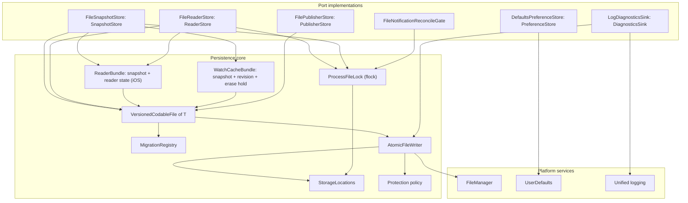

# Storage module

Status: Active

`ResetRadarStorage` is the local-persistence adapter of the [software architecture](../architecture.md). It implements the [Application](application.md) store ports with versioned JSON files, atomic replacement, cross-process locking, typed preferences, and redacted diagnostics, on every platform.

## Position

| Property | Value |
|---|---|
| Layer | Adapter |
| Platforms | iOS, macOS, watchOS |
| Depends on | [Domain](domain.md), [Application](application.md), Foundation, and OSLog |
| Implements | `SnapshotStore`, `ReaderStore`, `PublisherStore`, `PreferenceStore`, `NotificationReconcileGate`, `DiagnosticsSink` |
| Used by | Composition roots only |

Rules:

- No product decisions. The store enforces the atomic compare-and-swap a use case asks for, but the use case decides what "newer" means and when to commit.
- Never imports another adapter. Secrets never pass through this module; they belong to [Transport](transport.md).
- Every write is atomic, and every read validates before returning.

## Internal architecture

## Locations and protection

| Platform | Location | Protection |
|---|---|---|
| macOS | `~/Library/Application Support/ResetRadar/` | Owner-only `0700` directory and `0600` files. |
| iPhone and iPad | App Group container shared by the app and widget extension | `completeUntilFirstUserAuthentication`, so Lock Screen widgets, the App Intent, and background refresh can read after the first unlock. |
| Watch | Watch App Group container shared by the Watch app and complication | `completeUntilFirstUserAuthentication`. |

Debug builds use a separate `Debug` subdirectory, so a development build never reads or migrates the installed app's data.

## Stores

**`FileSnapshotStore`** holds the one committed `UsageSnapshot`. On Mac, `commitLocal(_:)` replaces the collected snapshot without assigning a relay sequence; `FilePublisherStore` owns the sequence when that snapshot is published. On iPhone and iPad, `commitRemote(_:sequence:ifGreaterThan:)` stores the accepted relay sequence and uses it for compare-and-swap. The iOS `FileSnapshotStore` and `FileReaderStore` are two port facades over one versioned `ReaderBundle` file containing both snapshot and reader state. A claim, result commit, pairing commit, Forget Mac, or receipt confirmation replaces that entire bundle atomically under one cross-process lock. A process killed between writes therefore sees either the old bundle or the new bundle, never an old snapshot with a new sequence or a cleared pairing with an old snapshot. On Watch, `commitWatch(_:deliveryRevision:)` writes one `WatchCacheBundle` containing the snapshot, relay sequence, iPhone installation ID, delivery revision, clear tombstone, and `localEraseHold`. It orders payloads by delivery revision, so a new publisher can start at a lower relay sequence after re-pairing. A clear removes the Watch snapshot while retaining its revision tombstone; a local erase also persists `localEraseHold`. Commits and `clear()` run under the container's `ProcessFileLock`, so the app and extension never interleave a read-modify-write.

**`FileReaderStore`** holds the iOS reader state:

- endpoint, publisher ID, and pairing floor;
- highest accepted sequence and ETag;
- last attempt, last success, and last contact times;
- transport status, backoff instant, and `needsAppReconcile`;
- a pairing staging marker and `awaitingActivation` state with the relay-assigned registration deadline, so a crash or lost activation response can be recovered without claiming a completed pairing;
- a pending manual-refresh request ID and deadline, so the app can display an interrupted wait accurately without replaying its POST;
- a random iPhone installation ID and a monotonically increasing Watch delivery revision, retained across Forget Mac and re-pairing.
- `forgetCleanupPending`, retained until Keychain deletion and local surface cancellation succeed;
- the last cleared Watch payload and `watchErasePending` revision, retained across Forget Mac, relaunch, and a new Mac pairing until a matching Watch receipt arrives; and
- the last confirmed Watch-erasure revision and time, retained for the Pairing & Sync read model.

`claimFetch(_:)` runs the use case's decision closure against the current `ReaderBundle` and records a unique claim ID, bounded in-flight lease, and the attempt in one locked replacement. A competing process observes the lease and reports `inProgress`; a crash leaves no permanent fetch lock. `commitResult` applies a result only while its claim ID still owns the lease, then writes reader state and snapshot in one replacement, including the accepted sequence and matching ETag. A widget-process commit also sets `needsAppReconcile` in that replacement. Pairing writes a staging marker before Keychain mutation; after both Keychain writes succeed, one bundle replacement commits the pairing metadata and any preflight snapshot as `awaitingActivation`. Startup recovery removes orphaned Keychain items when staging never reached that commit. Activation success clears the marker in a separate replacement; a lost response leaves retryable pending state. Forget Mac clears the prior ETag, accepted sequence, and in-flight claim, erases the iPhone snapshot, and persists `forgetCleanupPending` plus the Watch clear and pending marker in one replacement before any Watch send. A late result whose claim was removed cannot restore the snapshot, ETag, or transport status. `forgetCleanupPending` blocks pairing and fetch until Keychain and local-surface cleanup succeeds. A new pairing installs its own sequence floor without clearing `watchErasePending`. A matching Watch-erasure receipt removes that marker and records confirmation in one replacement; until then, the saved clear is the only Watch payload allowed. The installation ID and Watch delivery revision survive Forget Mac. A network request never runs while the lock is held. The caller holds a background-execution assertion for each locked section; see the [iOS app process model](ios-app.md#process-model).

**`FileNotificationReconcileGate`** uses a separate cross-process lock and a bounded claim for iOS reset-notification work. The use case reads the latest committed snapshot after claiming the gate. An interrupted claim leaves the `needsAppReconcile` flag set, so the app can repeat the idempotent schedule/cancel pass. No relay request occurs while the gate is held.

**`FilePublisherStore`** holds the Mac relay state: endpoint, publisher ID, paired-device names and dates, pending registrations, recently handled manual-refresh IDs and their encrypted result expiry, lifecycle state (`active`, `setupPending`, or `destroyPending`), and the sequence. `nextSequence()` atomically writes the incremented value before returning it, so a crash or retry can skip a number but never reuse one. Recently handled IDs keep a relay polling retry from starting another Codex read after a publication failure or process restart. A non-active lifecycle state prevents publication after a crash or relaunch.

**`DefaultsPreferenceStore`** wraps App Group or target-local `UserDefaults` with typed keys. Notification opt-in is stored per `HomeSlot` and per device, and is never synchronized.

**`LogDiagnosticsSink`** forwards `DiagnosticEvent`s to unified logging with privacy markers, and keeps a bounded ring-buffer file for the confirmed diagnostics export. Because events carry no free-form strings (see [Domain](domain.md#records)), the sink cannot log a token, path, or payload.

## Migration

Each file decodes into a version-tagged intermediate representation, validates it, and migrates one version at a time through `MigrationRegistry`. It atomically replaces the stored form only after the complete migration succeeds. An unknown mandatory version leaves the last valid file untouched and surfaces `incompatible`. No migration may turn an invalid percentage, timestamp, publisher, or sequence into accepted data.

On macOS, before the first write in a newer schema, the store copies the previous file to a recoverable backup next to it.

## Tests

`ResetRadarStorageTests` covers:

- interrupted atomic replacement and corrupted JSON;
- crash recovery for a single iOS `ReaderBundle` and Watch `WatchCacheBundle`, proving no split snapshot/sequence or snapshot/clear state after an interrupted replacement;
- every supported migration and an unknown mandatory version;
- compare-and-swap commit under concurrent writers, including two processes contending for `ProcessFileLock`;
- `claimFetch` under contention;
- in-flight lease expiry, late-result rejection, ETag invalidation after cache loss, and atomic reader-state/snapshot commit;
- two-process notification reconciliation after a widget-only reset change and interrupted reconciliation recovery;
- sequence persistence before return;
- pending relay setup/destroy state surviving relaunch and preventing publication;
- a manual-refresh result surviving a relaunch without repeating the Codex read, and a reader wait interrupted without reposting;
- a Forget Mac interruption that retains the clear intent, a late in-flight relay result rejected after forgetting, a stale Watch payload rejected after the clear tombstone, and a new pairing whose Watch payload waits for the matching erase receipt;
- file protection and permissions; and
- Debug and release location separation.
