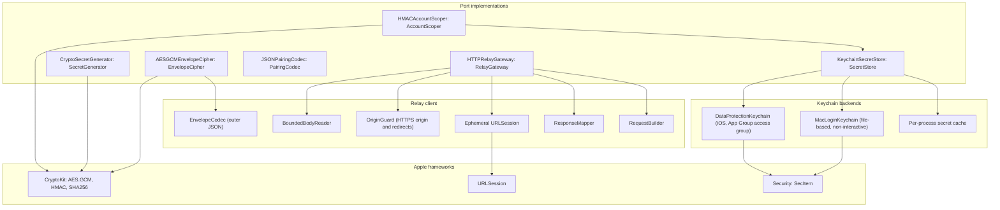

# Transport module

Status: Active

`ResetRadarTransport` is the security and relay-client adapter of the [software architecture](../architecture.md). It implements the [Application](application.md) ports for secrets, key generation, envelope encryption, account scoping, pairing packages, and HTTPS relay access on iOS and macOS.

## Position

| Property | Value |
|---|---|
| Layer | Adapter |
| Platforms | iOS, macOS |
| Depends on | [Domain](domain.md), [Application](application.md), Foundation, CryptoKit, and Security |
| Implements | `SecretStore`, `SecretGenerator`, `EnvelopeCipher`, `AccountScoper`, `PairingCodec`, `RelayGateway` |
| Used by | Composition roots only; never by Watch targets, extensions other than the iOS widget, or the status-line helper |

Rules:

- No product decisions: it seals, opens, authenticates, and maps responses, while use cases decide what to send, when, and what to commit.
- Never imports another adapter.
- Never shows a Keychain prompt. Every Keychain call is non-interactive and returns `interactionRequired` instead.
- Never logs or returns secrets, digests, ciphertext, or relay identifiers in errors.

## Internal architecture

## Key material

The Mac generates three independent random 256-bit values at relay setup:

1. the AES-GCM content-encryption key;
2. the relay write bearer token; and
3. the administration bearer token for reader management and destruction.

Each pairing additionally generates a unique random 256-bit read bearer token. At most three readers are registered at once, pending ones included.

| Holder | Material |
|---|---|
| Mac Keychain | Content key, write token, administration token, every registered read token, and the account-scope secret. |
| Each iPhone or iPad | The content key and its own read token, readable by the app and its widget extension. |
| Cloudflare | SHA-256 digests only. See [Relay](relay.md#state). |
| Watch | No key or relay credential. |

All readers share one content key. Revoking a reader therefore removes its relay access but cannot stop it from decrypting ciphertext it already holds. The content key never rotates in place: suspected compromise requires relay setup from scratch and complete re-pairing. The envelope's key version is reserved and always `1`.

## Secret store

`KeychainSecretStore` stores each secret as a non-synchronizing generic-password item under a fixed service name. Debug builds use a separate service name, so a development build never reads or overwrites the installed app's items. Errors are `notFound`, `interactionRequired`, or `unexpected` with a redacted status class.

**iOS: data-protection keychain.**
- Items use `kSecAttrAccessibleAfterFirstUnlockThisDeviceOnly`, so background refresh and widget reloads can decrypt after the first unlock.
- Every add, read, update, and delete explicitly supplies `kSecAttrAccessGroup` set to the shared App Group identifier. [Apple permits an App Group identifier as a Keychain access group](https://developer.apple.com/documentation/security/sharing-access-to-keychain-items-among-a-collection-of-apps), so the widget extension can read the read token and content key without a separate Keychain Sharing entitlement. Omitting this attribute would use a target's private default group and break extension reads.
- Before the first unlock after a restart, reads fail with `interactionRequired`, which ingestion reports as `secretsUnavailable`.

**macOS: file-based login keychain.**
- On macOS, the iOS-style data-protection keychain requires the `keychain-access-groups` entitlement. That entitlement must be authorized by a provisioning profile, and the Mac app deliberately has none.
- Items therefore live in the login keychain. Their access list trusts the creating app, identified by its code-signing designated requirement and team.
- Release builds of the Mac app are always signed with one Apple Development identity, so rebuilds and updates still satisfy that requirement, and access needs no interaction.
- Every call runs with user interaction disabled. A locked keychain or a changed signing identity therefore returns `interactionRequired` instead of a dialog.
- Secrets are read once per process into `SessionSecretCache`. A login Keychain already locked when the process starts makes that read fail and pauses publication. If the Keychain locks after a successful read, the running process retains the cached secrets and continues publication until quit, setup, destruction, or an explicit cache invalidation. Locking the Keychain is therefore not a stop-publishing action.
- Writing or deleting a secret invalidates its cached value before the operation returns. Relay setup and destruction also clear the complete per-process cache, so a running publisher cannot reuse superseded tokens or keys.

The signing contract and recovery behavior are in the [Mac app](mac-app.md#signing-and-keychain).

## Account scope

`HMACAccountScoper` computes HMAC-SHA-256 of the account identifier the Codex app-server reports, truncated to 128 bits. It is keyed by a random per-install secret in the Mac Keychain. The identifier is used only inside this call and is never stored, logged, or returned.

## Envelope

The outer JSON envelope exposes:

- protocol version and envelope version;
- publisher ID;
- strictly increasing unsigned sequence;
- encryption-key version;
- AES-GCM nonce;
- ciphertext; and
- authentication tag.

The nonce is 96 random bits generated per envelope. With one key and publication at most every 30 seconds, random nonces stay far below the collision bound. The whole `EnvelopeHeader` is authenticated additional data. The plaintext is the complete versioned `UsageSnapshot`, whose `publisherID` must match the header's. Opening fails on a wrong key, an altered header, or an altered ciphertext, and never returns partially authenticated data.

## Port shape

`RelayGateway` returns a `RelayOutcome` from every call and never throws for an HTTP result. List and registration calls return a `RelayResponse` that carries a value on success and a `RelayOutcome` otherwise. `RelayStatusContract` in `ResetRadarTestSupport` records the status table of the [relay protocol](relay.md#responses) as fixtures; `ResponseMapper` must map each row to its outcome. `SecretStore` methods throw only `SecretStoreError`, and `SecretValue` redacts itself from every string form and mirror. `SecretGenerator` adds `randomUnit()`, a non-secret value for backoff jitter. `PairingCodec` and `EnvelopeCipher` throw typed errors (`PairingCodecError`, `EnvelopeCipherError`) that carry no package or key content.

## Relay client

`HTTPRelayGateway` implements the operations in the [relay protocol](relay.md#protocol):

- **Session.** It uses an ephemeral `URLSession` with no URL cache and no cookies. Requests time out after 10 seconds and resources after 15 seconds, and the session does not wait for connectivity, so a background task or widget reload finishes inside its time budget.
- **Origin and redirects.** `OriginGuard` accepts only a canonical `https://` endpoint whose host is a subdomain of `workers.dev`, with the default HTTPS port and no user information, query, or fragment. Setup and pairing apply the same rule. Every request is built relative to that confirmed origin, and the `URLSessionTaskDelegate` refuses every HTTP redirect, including same-origin redirects. A `3xx` is a typed protocol failure; the client never retries it at the returned location or sends a token there.
- **Requests.** Tokens travel only in the `Authorization` header. Conditional reads send `If-None-Match`.
- **Responses.** `BoundedBodyReader` checks `Content-Length` when present, then counts delivered bytes while reading incrementally with `URLSession.bytes(for:delegate:)`; it cancels before buffering more than 64 KiB for a snapshot or 4 KiB for any other response, including errors. Missing or false lengths do not bypass the delivered-byte cap. `ResponseMapper` turns each bounded status and body into a typed `RelayOutcome`, which use cases map to `TransportStatus`. An oversized or malformed response preserves the last validated cache and does not update its ETag or successful-contact time.
- **Pairing activation.** The gateway carries the relay-assigned registration deadline from registration into the package, preflight-reads without activation, and sends a body-free activation POST after the application commits locally. A lost response can be retried with the same token; a local clock deadline never substitutes for a relay `401`.
- **Manual refresh.** The gateway posts a request ID with the reader token, lists and acknowledges requests with the Mac write token, and uses the same conditional snapshot GET for the reader's bounded wait. It never treats an accepted request, `304`, or a plain newer snapshot as proof that Codex was read; only an authenticated matching `ManualRefreshResult` proves completion.
- **No certificate pinning.** Content is authenticated end to end, and `workers.dev` certificates rotate under Cloudflare's control.

## Pairing package codec

`JSONPairingCodec` encodes a `PairingPackage` as compact JSON, then base64url. The same string is shown as the QR code and offered for manual copy and paste. Decoding rejects unknown mandatory versions, endpoints outside `OriginGuard`'s canonical `workers.dev` HTTPS rule, missing or malformed reader IDs, keys or tokens of the wrong length, and an expired or implausibly distant relay-assigned registration deadline. Both devices show a pairing confirmation code made from the first 8 bytes of SHA-256 over the exact encoded package string, grouped for reading. The owner compares this code on the Mac and reader before confirmation; it covers the endpoint, reader ID, token, content key, publisher ID, key version, sequence floor, and deadline. A separate publisher fingerprint, the first 8 bytes of SHA-256 over the publisher ID, remains useful for later device identification but is insufficient by itself to authenticate the pairing package.

The Mac offers manual copying only after an explicit action and a warning that the package contains a content key which remains usable after the five-minute registration deadline. Its general pasteboard may participate in Universal Clipboard; the app cannot revoke a copy already delivered to another device. The Mac stores only a local SHA-256 digest, `NSPasteboard.changeCount`, and expiry for cleanup, never the package bytes outside the live pairing view. At activation, view closure, expiry, and next launch, it clears the general pasteboard only when both the change count and digest still match the value Reset Radar wrote; it never overwrites unrelated clipboard content. The iPhone or iPad reads the package only from an explicit Paste action and applies the same confirmation-code check as QR pairing. A suspected copied-package leak requires relay destruction and re-pairing, because reader revocation alone cannot withdraw the shared content key.

## Tests

`ResetRadarTransportTests` covers:

- seal and open round trips, a wrong key, an altered header, altered ciphertext, and a truncated tag;
- envelope fixtures shared with the relay;
- every response mapping;
- canonical origin rejection, same-origin and cross-origin redirects, HTTPS-to-HTTP redirects, and token non-forwarding for read, write, and administration roles;
- missing or deceptive `Content-Length`, oversized snapshot and error responses, and a failed response leaving the validated cache and ETag unchanged;
- pairing package encoding, decoding, rejection, and confirmation-code mismatch after tampering with each package field;
- pairing clipboard cleanup when unchanged, preservation after another app changes the clipboard, and relaunch cleanup using only a digest and change count;
- HMAC determinism without retaining the identifier;
- secret-store error mapping against a stubbed Keychain backend; and
- cache invalidation on write, delete, setup replacement, and destruction.

The real Keychain is never exercised in the gate: unit tests use the in-memory `SecretStore` from `ResetRadarTestSupport`. Real Keychain behavior is proven on the reference devices; see [Platform behavior](../architecture.md#platform-behavior-to-be-proven-on-real-runtimes).
