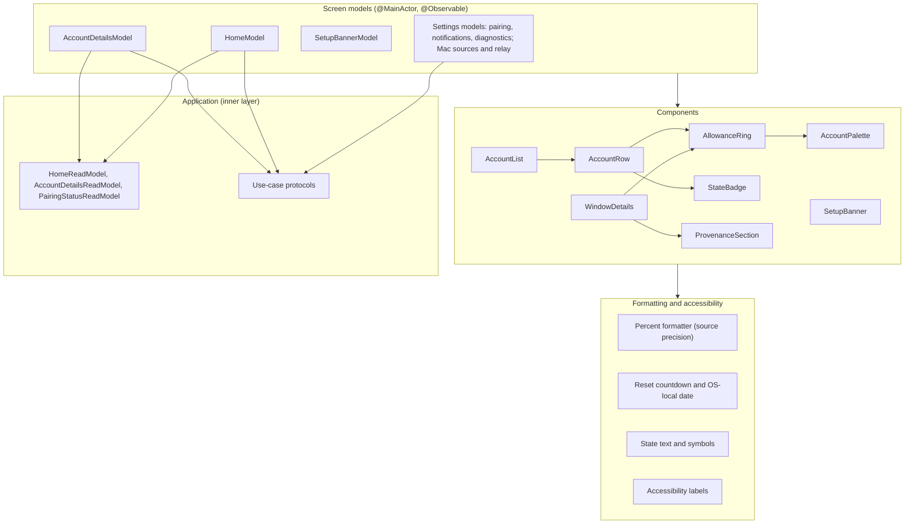

# UI module

Status: Active

`ResetRadarUI` is the presentation adapter of the [software architecture](../architecture.md). It turns [Application](application.md) read models into SwiftUI views on iPhone, iPad, Mac, and Apple Watch, and forwards user intents to use cases. It owns the shared components named in [ux-terms.md](../ux-terms.md).

## Position

| Property | Value |
|---|---|
| Layer | Adapter (presentation) |
| Platforms | iOS, macOS, watchOS |
| Depends on | [Domain](domain.md), [Application](application.md), and SwiftUI |
| Used by | Composition roots: apps, widget extension, and complication extension |

Rules:

- Never imports a storage, transport, scheduling, link, or source adapter. Views receive read models and call use-case protocols injected by the composition root.
- Never derives business state itself. Presentation state, standard account-window resolution, and liveness come from Domain policies through the read models; views only format them.
- Never presents remaining percentage, history, forecasts, pace, or threshold controls.
- Color never carries state alone: every state also has text, a symbol, and an accessibility label.

## Internal architecture

## Screen models

**Home and Account Details.** `HomeModel` and `AccountDetailsModel` load their read model when they
appear. They re-load when the composition root signals a commit, and at the read model's next-
change instant, using a `TimelineView` schedule. This keeps countdowns and stale transitions moving
without polling storage.

**Actions.** Refresh, notification opt-in, Start Live Activity, pairing, and the diagnostics export each call one injected use case and show its typed outcome.

**Pairing and erasure.** The iPhone Settings model consumes `PairingStatusReadModel` and distinguishes local Forget Mac completion, pending Watch cache erasure, and a matching Watch receipt. It never labels a rendered complication frame as erased on the basis of that receipt. The Watch Settings model calls the owner-confirmed `EraseWatchData` use case and shows the local delivery hold until Reset Watch Pairing.

**Setup Banner.** `SetupBannerModel` shows the single next blocker in this priority order:

1. not paired;
2. secrets unavailable;
3. authorization required;
4. source not set up; then
5. incompatible.

## Components

| Component | Notes |
|---|---|
| `AccountList` | Account rows in localized natural alias order, with stable account number as the tie-breaker. It is a vertical list on iPhone and the leading pane on iPad and Mac. |
| `AccountRow` | Small top-leading alias label, product, five-hour and weekly rings, account status symbols, and the neutral bitmap Account Details action. It may reflow for accessibility sizes without changing logical order; the alias becomes inline-editable only in the Mac composition. |
| `AccountPalette` | Watch-only appearance-aware surface/foreground pair derived from the stable global account number: #1 lavender, #2 mint, and #3 peach. The surface stays pastel while the foreground meets contrast requirements; status remains independently encoded by text, symbol, and accessibility. |
| `AllowanceRing` | Fills from 0% toward 100% used. It shows no value for `unavailable` and `resetAwaitingRefresh`, and a stale treatment for `stale`. |
| `WindowDetails` | Ring, exact percentage, window label, relative countdown, absolute reset in the OS's current time zone, observation time, and state explanation. |
| `ProvenanceSection` | Acquisition source, Mac liveness, last successful sync on this device, and compatibility. Versions and errors sit behind a disclosure. |
| `StateBadge` | Text, symbol, and accessibility label for every presentation and transport state. |

Widget, Live Activity, and complication views reuse `AllowanceRing`, `StateBadge`, and the formatters. Their WidgetKit containers live in the extension targets.

## Platform variants

| Platform | Variant |
|---|---|
| iPhone | Main Toolbar content. |
| iPad | Same screens within the adaptive tab bar or sidebar. |
| macOS | Main Sidebar content and the menu-bar summary. |
| watchOS | N-by-two ring matrix with stable pastel account palettes and compact Account Details, with no notification or Live Activity controls. |

Variants live in platform-conditional files; screen models are shared.

## Tests

`ResetRadarUIComponentTests` (named to avoid the app's `ResetRadarUITests` UI-test bundle) covers:

- screen-model state for every presentation and transport state;
- pairing and Watch-erasure state, including an unreachable Watch and a confirmed cache receipt;
- stable #1 lavender, #2 mint, and #3 peach Watch Account Palette mapping across account order and
  supported appearances, including foreground contrast;
- formatter output across precisions and time zones; and
- accessibility labels.

Navigation and layout are covered by the iOS app's UI tests on the iPhone and iPad simulators.
