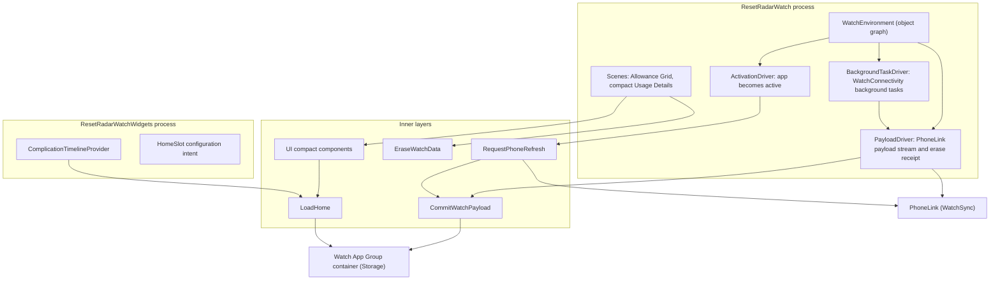

# Watch app

Status: Proposal

The Watch app is a composition root of the [software architecture](../architecture.md): `ResetRadarWatch` and its `ResetRadarWatchWidgets` complication extension. It receives normalized snapshots from the paired iPhone, commits them to the Watch's own cache, and asks the iPhone for a refresh when opened. It never contacts a provider or the relay, and holds no relay credential.

## Position

| Property | Value |
|---|---|
| Layer | Composition root (frameworks and drivers) |
| Targets | `ResetRadarWatch` (Watch app) and `ResetRadarWatchWidgets` (WidgetKit complication extension, embedded in the Watch app) |
| App imports | [Domain](domain.md), [Application](application.md), [Storage](storage.md), [WatchSync](watch-sync.md), and [UI](ui.md) |
| Complication imports | Domain, Application, Storage, and UI |

Rules:

- Never imports Transport, so no code path can reach the relay or a secret.
- Drivers carry no policy: ordering is `CommitWatchPayload`'s, and presentation state is Domain's.

## Internal architecture

## Data flow

| Event | Handling |
|---|---|
| Application context or complication transfer arrives | `PayloadDriver` passes it to `CommitWatchPayload`, which applies the iPhone installation ID and delivery-revision ordering rules in [Application](application.md#watch-watchos), replaces one `WatchCacheBundle` atomically in the Watch App Group, and reloads the complication. |
| Delivery while the app is in the background | `BackgroundTaskDriver` holds the WatchConnectivity background task until `PayloadDriver` has drained pending content, then completes it. |
| The app becomes active | `ActivationDriver` calls `RequestPhoneRefresh`. If the iPhone is reachable, the request can wake the iPhone app, which ingests from the relay and replies with a payload; otherwise the Watch shows its aged cache immediately and awaits ordinary delivery. |
| Forget Mac on the iPhone | A cleared payload erases the Watch cache, retains a revision tombstone, requests a complication reload, and queues a `WatchEraseReceipt` to the iPhone. Duplicate clears requeue the receipt. If the Watch is offline, its previous cache remains until delivery or the owner clears it locally. |
| iPhone app data is erased or reinstalled with a new installation ID | The Watch keeps its last cache and asks the owner to confirm Reset Watch Pairing before accepting the new installation's payload. Erase Watch Data is also available locally. |
| iPhone unreachable or unpaired | The last valid cache is kept, and presentation state keeps ageing from the original `observedAt`. |

The Watch app offers an owner-confirmed **Erase Watch Data** action. It clears its local snapshot, retains the last revision tombstone, sets a durable `localEraseHold`, and requests a complication reload. This is available without the iPhone, including after the iPhone app is erased or reinstalled. While the hold is set, the Watch may accept a newer clear and return its receipt, but it rejects usage payloads until the owner explicitly chooses **Reset Watch Pairing**. It does not claim to revoke a relay token; the Watch has none. The system may continue to display an old complication frame until watchOS processes the reload or the owner removes the complication.

## Scenes

Watch Home is the Allowance Grid with a navigation stack to compact product-scoped Usage Details, with both standard windows. There is no Main Toolbar, notification control, or Live Activity control. Reset notifications appear on the Watch only through the system's forwarding of iPhone notifications. [ux-gui.md](../ux-gui.md) is authoritative for layout.

## Complication

`ComplicationTimelineProvider` reads only the Watch App Group cache through `LoadHome`, for the `HomeSlot` chosen in its configuration intent. It emits an entry now plus one at each presentation-state change instant, and requests its next reload at the earlier of the next change instant and fifteen minutes from now. Every family shows presentation state without relying on color alone.

## Configuration

| Item | Value |
|---|---|
| Deployment target | watchOS 26.6 (see [Platform targets](../architecture.md#platform-targets)) |
| App Group | The same identifier as iOS, giving the Watch app and complication their own container on the Watch |
| Bundle identifier | Prefixed by the iOS app's identifier |
| Excluded | No network or Keychain access for relay data |

## Tests

`ResetRadarWatchTests` covers:

- payload ordering, replayed clears, durable clear tombstones, duplicate erase receipts, re-pairing, a changed iPhone installation ID, and local erase through `CommitWatchPayload` with a stubbed `PhoneLink`;
- background-task completion after the payload drains;
- the activation refresh request; and
- complication timeline entries and reload dates.

Real delivery and complication reload are proven on the paired reference devices.
