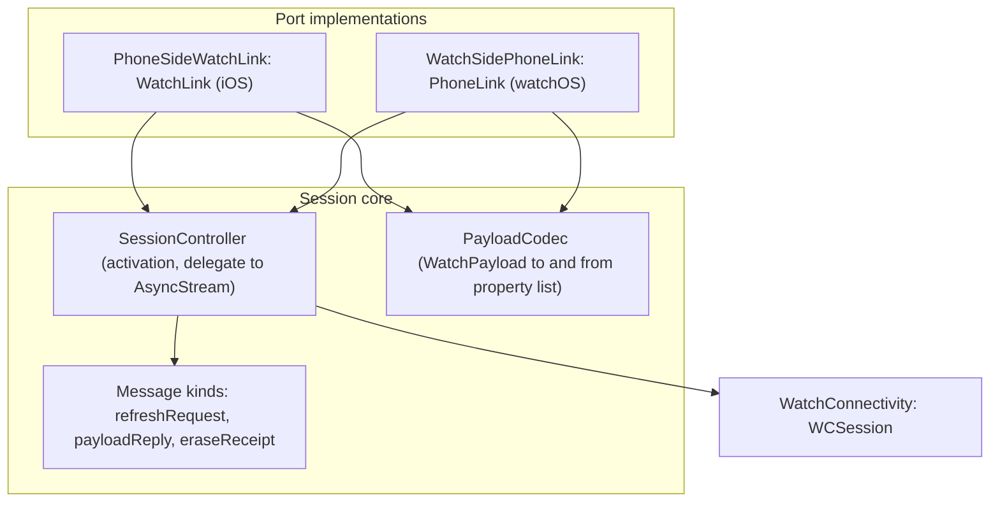

# WatchSync module

Status: Proposal

`ResetRadarWatchSync` is the iPhone-to-Watch link adapter of the [software architecture](../architecture.md). It moves versioned `WatchPayload`s, refresh requests, and Watch-erasure receipts over WatchConnectivity, and leaves every ordering and commit decision to the [Application](application.md) use cases.

## Position

| Property | Value |
|---|---|
| Layer | Adapter |
| Platforms | iOS (iPhone) and watchOS; it compiles to an inert stub on iPad and macOS, where WatchConnectivity is unsupported or absent |
| Depends on | [Domain](domain.md), [Application](application.md), and WatchConnectivity |
| Implements | `WatchLink` on iOS and `PhoneLink` on watchOS |
| Used by | Composition roots: the iOS app and the Watch app |

Rules:

- No storage and no decisions. It never decides whether a payload is newer, when to spend complication transfers, or what to commit.
- Never imports another adapter. The Watch side never sees a relay secret, because payloads carry only the normalized snapshot and transport status.

## Internal architecture

## Channels

| Channel | Direction | Use |
|---|---|---|
| `updateApplicationContext` | iPhone to Watch | The authoritative, last-value channel for every committed payload and transport-status change. It is delivered in the background, even when the Watch app isn't running. |
| `transferCurrentComplicationUserInfo` | iPhone to Watch | A faster, budgeted delivery of the same payload for the complication, sent only when `ComplicationBudgetPolicy` allows. |
| `sendMessage` with reply | Watch to iPhone | A refresh request from the active Watch app when `isReachable` is true. It can wake the reachable iPhone app in the background; the reply carries the resulting payload. |
| `transferUserInfo` | Watch to iPhone | A small, queued `WatchEraseReceipt` after a cleared payload is durably committed. It can arrive after the iPhone app is suspended; duplicates are accepted idempotently. |

`SessionController` activates `WCSession` at launch on both sides and checks `isPaired` and `isWatchAppInstalled` before iPhone sends. The Watch checks `isReachable` before an interactive request; when false, it returns the cached view immediately and waits for normal application-context delivery. Apple documents this [reachability requirement](https://developer.apple.com/documentation/watchconnectivity/wcsession). It reports `remainingComplicationUserInfoTransfers` and `isComplicationEnabled` to the budget policy. Incoming payloads from both iPhone channels are surfaced as one `AsyncStream`; incoming erase receipts are a separate typed stream on the iPhone. Refresh requests are surfaced to the iPhone app with a reply continuation that the app must complete. `PayloadCodec` wraps each versioned payload or receipt in a one-key property-list dictionary, so no usage or relay secret enters a receipt.

The iPhone keeps the saved cleared payload as application context until a matching receipt arrives; it never replaces that context with a newer usage snapshot while erasure is pending. The Watch queues a receipt only after committing the empty cache and requesting a complication reload. It may queue the same receipt again after an identical clear or after relaunch; the iPhone deduplicates by installation ID and revision. [Apple documents](https://developer.apple.com/documentation/watchconnectivity/transferring-data-with-watch-connectivity) queued `transferUserInfo` delivery and last-value application context, but neither provides a deadline or remote-erasure guarantee while the Watch is unreachable. A receipt confirms the Watch cache transaction, not immediate removal of a previously rendered complication frame.

## Tests

`ResetRadarWatchSyncTests` covers payload and receipt encoding and decoding, unknown versions, message-kind routing, unreachable-phone fallback, queued duplicate receipts, and reply completion, against a stubbed session. Real delivery, background wake, offline clear and later receipt, and the complication budget are proven on the paired reference devices; see [Platform behavior](../architecture.md#platform-behavior-to-be-proven-on-real-runtimes).
