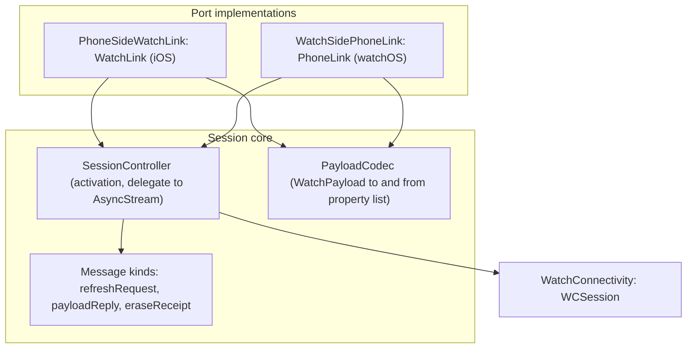

# WatchSync module

Status: Active

`ResetRadarWatchSync` is the iPhone-to-Watch link adapter of the [software architecture](../architecture.md). It moves versioned `WatchPayload`s, refresh requests, and Watch-erasure receipts over WatchConnectivity, and leaves every ordering and commit decision to the [Application](application.md) use cases.

## Position

| Property | Value |
|---|---|
| Layer | Adapter |
| Platforms | iOS (iPhone) and watchOS; it compiles to an inert stub on iPad and macOS, where WatchConnectivity is unsupported or absent |
| Depends on | [Domain](domain.md), [Application](application.md), and WatchConnectivity |
| Implements | `WatchLink` on iOS and `PhoneLink` on watchOS |
| Used by | Composition roots: the iOS app and the Watch app |

Rules:

- No storage and no decisions. It never decides whether a payload is newer, when to spend complication transfers, or what to commit.
- Never imports another adapter. The Watch side never sees a relay secret, because payloads carry only the normalized snapshot and transport status.

## Internal architecture

## Channels

| Channel | Direction | Use |
|---|---|---|
| `updateApplicationContext` | iPhone to Watch | The authoritative, last-value channel for every committed payload and transport-status change. It is delivered in the background, even when the Watch app isn't running. |
| `transferCurrentComplicationUserInfo` | iPhone to Watch | A faster, budgeted delivery of the same payload for the complication, sent only when `ComplicationBudgetPolicy` allows. |
| `sendMessage` with reply | Watch to iPhone | A refresh request from the active Watch app when `isReachable` is true. It can wake the reachable iPhone app in the background; the reply carries the resulting payload. |
| `transferUserInfo` | Watch to iPhone | A small, queued `WatchEraseReceipt` after a cleared payload is durably committed. It can arrive after the iPhone app is suspended; duplicates are accepted idempotently. |

`WCSessionBridge` activates `WCSession` at launch on both sides and waits for its activation callback before composition sends. On iPhone it checks `isPaired` and `isWatchAppInstalled`; the Watch checks `isReachable` before an interactive request and otherwise returns the cached view immediately. Apple documents this [reachability requirement](https://developer.apple.com/documentation/watchconnectivity/wcsession). It reports `remainingComplicationUserInfoTransfers` and `isComplicationEnabled` to the budget policy. Incoming payloads from both iPhone channels are decoded into one `AsyncStream`; incoming erase receipts are a separate typed stream on the iPhone. A Watch-side drain tracker keeps a watchOS WatchConnectivity background task alive until each yielded payload has completed durable commit and reload-request work. Refresh requests use a one-shot reply handler. `WatchWireCodec` accepts only the current explicit kind and key set, bounds the binary property list to 64 KiB and its outer nesting to 32 levels, and wraps only a versioned payload or receipt body; no usage or relay secret enters a receipt.

The iPhone keeps the saved cleared payload as application context until a matching receipt arrives; it never replaces that context with a newer usage snapshot while erasure is pending and replays the clear after launch or session activation. The Watch persists a receipt in the same transaction that commits the empty cache, requests a complication reload, and clears the pending marker only after WatchConnectivity accepts it for queuing. It retries after an identical clear or app activation; the iPhone deduplicates by installation ID and revision. [Apple documents](https://developer.apple.com/documentation/watchconnectivity/transferring-data-with-watch-connectivity) queued `transferUserInfo` delivery and last-value application context, but neither provides a deadline or remote-erasure guarantee while the Watch is unreachable. A receipt confirms the Watch cache transaction, not immediate removal of a previously rendered complication frame.

## Tests

`ResetRadarWatchSyncTests` covers payload and receipt encoding and decoding, bounds and unknown versions, session-state gating, message-kind routing, unreachable-phone fallback, receipt envelopes, and payload-drain completion against an injected session. Application tests cover queued duplicate receipts, deadline replies, ordering, and budget reservation. Real delivery, background wake, offline clear and later receipt, and the complication budget are proven on the paired reference devices; see [Platform behavior](../architecture.md#platform-behavior-to-be-proven-on-real-runtimes).
