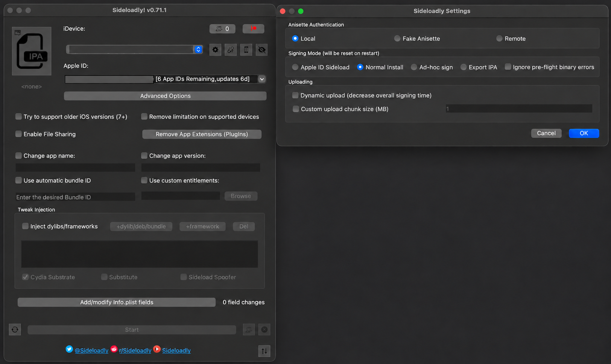

# Sideload Reset Radar with Sideloadly

Status: Active

This guide installs an Xcode-signed Reset Radar IPA on the owner's iPhone or iPad with
Sideloadly. It covers the verified Sideloadly 0.71.1 **Normal Install** flow; automatic renewal,
widget preservation, iPad installation, and paired-Watch preservation still require physical-device
evidence.

## Before you start

You need:

- the Apple-silicon Mac, Xcode, and Apple-platform versions listed in
  [Platform targets](architecture.md#platform-targets);
- the owner's free Apple Account added to **Xcode → Settings → Apple Accounts**, with its
  **Personal Team** selected;
- [Sideloadly](https://sideloadly.io/) downloaded from its official site;
- the iPhone or iPad, a USB cable, and the device passcode; and
- this repository with Release signing configured for the same Personal Team.

Use only the owner's account, app, and devices. Keep Apple credentials, device identifiers,
signing files, IPAs, pairing packages, relay tokens, and usage data out of screenshots, chat,
logs, and the repository.

## 1. Configure Release signing

This is a one-time setup for the Mac. Skip it when the untracked
`Config/Build/Local.xcconfig` already contains the correct Personal Team.

1. Connect the device by USB, unlock it, and accept **Trust This Computer** on the device.
2. Generate and open the Xcode project:

   ```sh
   Scripts/generate-project.sh
   open ResetRadar.xcodeproj
   ```

3. In Xcode, select the **ResetRadar** target and open **Signing & Capabilities → Release**.
   Enable **Automatically manage signing** and select the owner's **Personal Team**.
4. Copy the template if the local file does not exist:

   ```sh
   cp Config/Build/Local.xcconfig.template Config/Build/Local.xcconfig
   ```

5. In the untracked `Config/Build/Local.xcconfig`, set `DEVELOPMENT_TEAM` to the 10-character
   team identifier from the generated project's Release signing setting. Keep
   `CODE_SIGN_IDENTITY = Apple Development` and add `CODE_SIGN_STYLE = Automatic`.
6. Run `Scripts/generate-project.sh` again. Confirm the iOS app, iOS widget, Watch app, and Watch
   widget all use that same team for Release. Do not commit `Local.xcconfig`.

## 2. Build the signed IPA

From the repository root, run:

```sh
make ipa
```

The command creates `.build/ipa/ResetRadar.ipa`. It deliberately preserves an existing package,
so move the old file aside before running the command when you need a new export. Do not share or
commit the IPA; it contains owner-specific signing material.

## 3. Choose the safe Sideloadly settings

1. Open Sideloadly and load `.build/ipa/ResetRadar.ipa` by dragging it onto the IPA area.
2. Under **iDevice**, select the connected iPhone or iPad explicitly. If the only destination is
   **Apple Silicon**, stop: that would install to the Mac. Reconnect and trust the device, then
   confirm that Xcode also sees it as a device destination.
3. Open Sideloadly Settings with the gear button. Keep **Anisette Authentication → Local**, select
   **Signing Mode → Normal Install**, and choose **OK**. Signing Mode resets when Sideloadly
   restarts, so check it on every install.
4. Under **Advanced Options**:
   - turn **Use automatic bundle ID** off;
   - keep app-extension removal off and confirm Sideloadly will drop zero plug-ins;
   - leave custom app name, version, bundle ID, entitlements, and older-iOS options unset;
   - leave tweak injection off; and
   - leave AutoRefresh off if Sideloadly shows that option.



The example uses **Normal Install**, keeps the automatic bundle-ID option off, and retains app
extensions. The Apple Account, device details, and personal desktop background are intentionally
redacted. **Normal Install** installs the IPA already signed by Xcode, so this flow does not require
entering an Apple Account password or two-factor code in Sideloadly.

Do not use **Apple ID Sideload** for this package. With the owner's free account, Sideloadly 0.71.1
requires automatic bundle-ID changes in that mode. Changing Reset Radar's identity would break its
fixed App Group and Keychain contract.

## 4. Install and trust the app

1. Select **Start** and wait for Sideloadly to report 100% completion.
2. If iOS requires Developer Mode, open **Settings → Privacy & Security → Developer Mode**, enable
   it, restart the device, and confirm with the device passcode.
3. If the first launch reports **Untrusted Developer**, open
   **Settings → General → VPN & Device Management**, select the owner's development identity under
   **Developer App**, and follow the **Trust** or **Allow & Restart** prompt. Keep the device online
   while iOS verifies the certificate.
4. Unlock the device after the restart and launch Reset Radar.

## 5. Check the installation

After the first launch:

1. Confirm Reset Radar reaches its setup screen without reporting that it cannot open its data.
2. Pair with the Collector Mac by scanning its QR code or explicitly pasting a newly created
   Pairing Package. Compare the complete Pairing Confirmation Code on both devices before
   accepting it.
3. Wait for activation and one authenticated publication. Lock and unlock the device, relaunch
   Reset Radar, and confirm that the pairing and cached rows remain.
4. Record only a sanitized pass/fail result. Do not capture the pairing package, confirmation
   code, account identifiers, relay token, or provider usage.

The initial iPhone installation, trust flow, launch, and QR pairing have passed on the reference
iPhone. Widget behavior, first-unlock and cache preservation, the reference iPad, the embedded
Watch app, and renewal preservation remain open checks; do not treat this guide as evidence that
those paths pass.

## Run the Watch app from Xcode

If installation from the iPhone's Watch app remains on **Installing**, keep the existing iPhone
installation and run the Watch app directly from Xcode:

1. Connect the paired iPhone to the Mac, unlock both devices, and confirm that the physical Watch
   appears in Xcode's Device Hub. Enable Developer Mode on both devices if Xcode requests it.
2. Open the generated `ResetRadar.xcodeproj`, select the **ResetRadarWatch** scheme and the physical
   Watch destination. Confirm **Product → Scheme → Edit Scheme → Run → Info** uses **Release**.
   Regenerate the project first with `make generate` if the scheme still says **Development**.
3. Confirm **Signing & Capabilities → Release** for the Watch app and Watch complication both use
   the same Personal Team as the installed iPhone app, then choose **Product → Run**. Accept any
   Watch registration or trust prompt. Xcode installs the Watch app without replacing the iPhone
   app.

The generated Watch scheme uses Release because Development explicitly disables code signing.
An Xcode error mentioning `Development-watchos/ResetRadarWatch.app` and “No code signature found”
means the Run action still selected Development. A signed Release build failing installation needs
its own Xcode error diagnosis; do not change bundle identifiers, entitlements, or the existing
iPhone installation to hide it.

## Renew before seven days

A free Personal Team provisioning profile expires after seven days. Reset Radar's currently
approved renewal candidate is a fresh Xcode-signed IPA installed again with **Normal Install** and
the same Personal Team. Automatic Sideloadly re-signing is not yet validated for this fixed-identity
package.

Before the current profile expires:

1. move the existing `.build/ipa/ResetRadar.ipa` aside;
2. run `make ipa` with the same `Local.xcconfig` and Personal Team;
3. repeat the **Normal Install** steps; and
4. confirm pairing, cached readings, widget configuration, and Watch state were preserved.

If the app appears as a second installation, loses its pairing or cache, cannot open shared data,
or Sideloadly changes its bundle identity, stop. Do not delete the old app, weaken entitlements, or
accept re-pairing as equivalent renewal evidence.

## Troubleshooting

| Problem | What to do |
|---|---|
| The device is missing from **iDevice** | Reconnect by USB, unlock it, accept trust on both sides, and confirm it appears in Xcode. A Finder Wi-Fi entry alone does not prove USB detection. |
| **Start** is disabled | Confirm that the IPA is loaded and the physical device—not **Apple Silicon**—is selected. |
| Sideloadly reopened in another signing mode | Return to Settings and select **Normal Install** again before starting. |
| iOS reports **Untrusted Developer** | Complete the **VPN & Device Management** trust flow above while the device is online. |
| `make ipa` says the IPA already exists | Move only `.build/ipa/ResetRadar.ipa` aside, then rerun the command. |
| Pairing or shared data disappears after reinstall | Stop the renewal test and preserve the existing app and evidence. Do not change bundle IDs, App Groups, Keychain groups, or entitlements. |
| The iPhone Watch app stays on **Installing** | Use the signed Watch scheme's direct Xcode run procedure above and retain the iPhone installation. |

Maintainers who need the package inspection commands and evidence boundaries should use the
[owner-run installation procedure](research/personal-use-sideloading.md#p1-m14-reader-installation-procedure).
